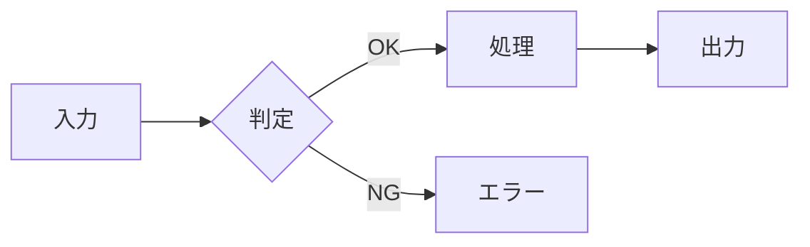

# 技術解説スライドのひな形

写して使う。_ で始まるファイルは公開されない

---

# コードブロック

```cpp
#include <vector>
#include <iostream>

int main() {
  std::vector<int> v{3, 1, 4, 1, 5};
  int sum = 0;
  for (int x : v) {
    sum += x;
  }
  std::cout << sum << "\n";
  return 0;
}
```

---

# 処理の流れ



---

# 数式

$$
\int_{0}^{1} x^2 \, dx = \frac{1}{3}
$$

---

# 画像


