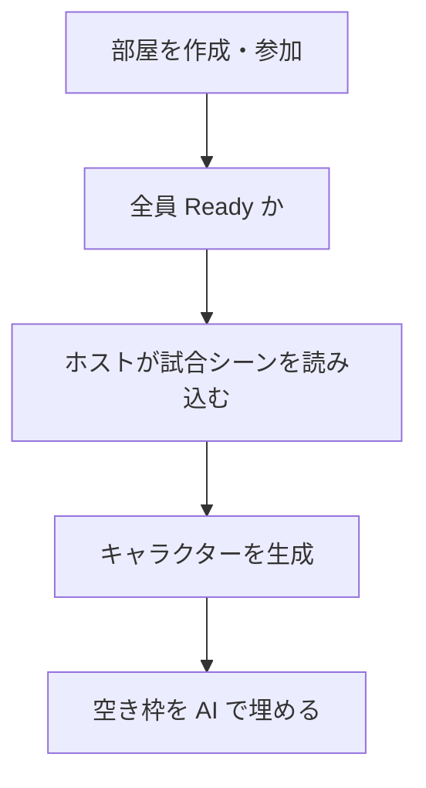

# Ballistic

3対3のサッカーと三人称シューターを組み合わせた対戦ゲーム

<p class="dim">2026.08 - 現在 / スキル・ULT、ネットワーク担当（10人チーム） / Unity・C#・Netcode for GameObjects</p>

---
layout: two-cols
---

# 撃って、ボールを押し出して、ゴールを狙う

<v-clicks>

- キャラクターごとにスキルと必殺技（ULT）がある
- オフラインの AI 戦と、最大6人のオンライン対戦
- チームは10人。自分は**スキル・ULT**と**ネットワーク**担当

</v-clicks>

::right::

<div>



</div>

<p class="dim">オンライン対戦が始まるまで</p>

---
layout: two-cols
---

# ULT は数値をデータに、処理を実行クラスに分ける

<v-clicks>

- 数値は ScriptableObject に置く
- 処理は ULT ごとの実行クラスが持つ
- `UltimateController` が実行する
- ゲージは時間・ダメージ・撃破・ボール・味方のゴールで溜まる

</v-clicks>

::right::

<div class="dim" style="margin-top: 5rem">実装した6種類</div>

- 武器を火炎弾に変える
- 「響き」を消費して回復
- 咆哮で敵を封印、味方を強化
- 狙った場所に壁を置く
- ダメージ・回復・押し出しのビーム
- 敵やボールを飛ばす溜めキック

---

# 発動してよいかは、3つの状態を見てから実行する

```csharp {3-4|6-7|9-10|all}
public bool TryActivate()
{
    if (!CharacterNetSync.IsControlledHere(gameObject))
        return false;

    if (_health != null && _health.IsDead)
        return false;

    if (_gameManager != null && _gameManager.IsGameplayLocked)
        return false;

    // ...
}
```

<p class="dim">自分の端末か / 倒れていないか / ゴール演出中でないか</p>

---

# 専用サーバーなし。部屋を作った人がホスト

<v-clicks>

- Unity Gaming Services のセッションと Relay で接続し、Netcode for GameObjects で同期
- 試合の進行はホストが決め、`MatchNetSync` が各端末へ伝える
- ダメージは撃った側が申告し、**ホストが確かめてから**体力に反映
- 空き枠や途中で抜けた枠は AI が引き継ぐ

</v-clicks>

---

# 全員が準備完了したら、ホストが試合シーンを読み込む

```csharp {1-5|7-14|all}
public bool CanStartMatch()
{
    return IsHost && CurrentSession.Players.Count >= 2 &&
           CurrentSession.Players.All(IsReady);
}

public void StartMatch()
{
    if (_matchStarted || !CanStartMatch())
        return;

    _matchStarted = true;
    NetworkManager.Singleton.SceneManager.LoadScene(SceneNames.Game, LoadSceneMode.Single);
}
```

---

# 判断と振り返り

<v-clicks>

- **自分で決めたこと**: 専用サーバーを置かず、部屋を作った人がホストになる方式
- **理由**: 専用サーバーだと、開発中もサーバー費用がかかり続けるため
- **ULT の分け方**: プランナーが作業しやすい形。作り直しもしやすくなった
- **いまの状態**: ネットワークの部分は開発中

</v-clicks>

---

# 詳しくはこの下の本文へ

<p class="dim">ULT の実装とネットワークの構成を本文で説明しています</p>
