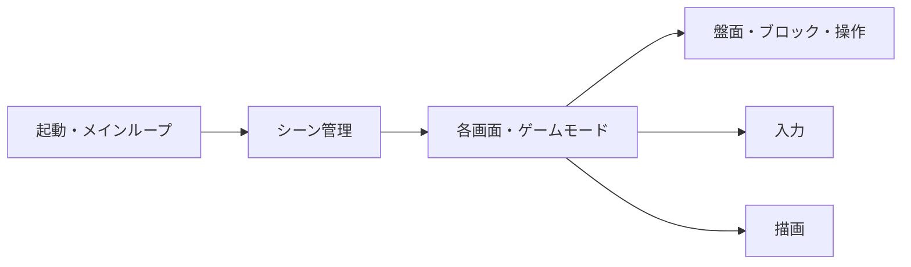
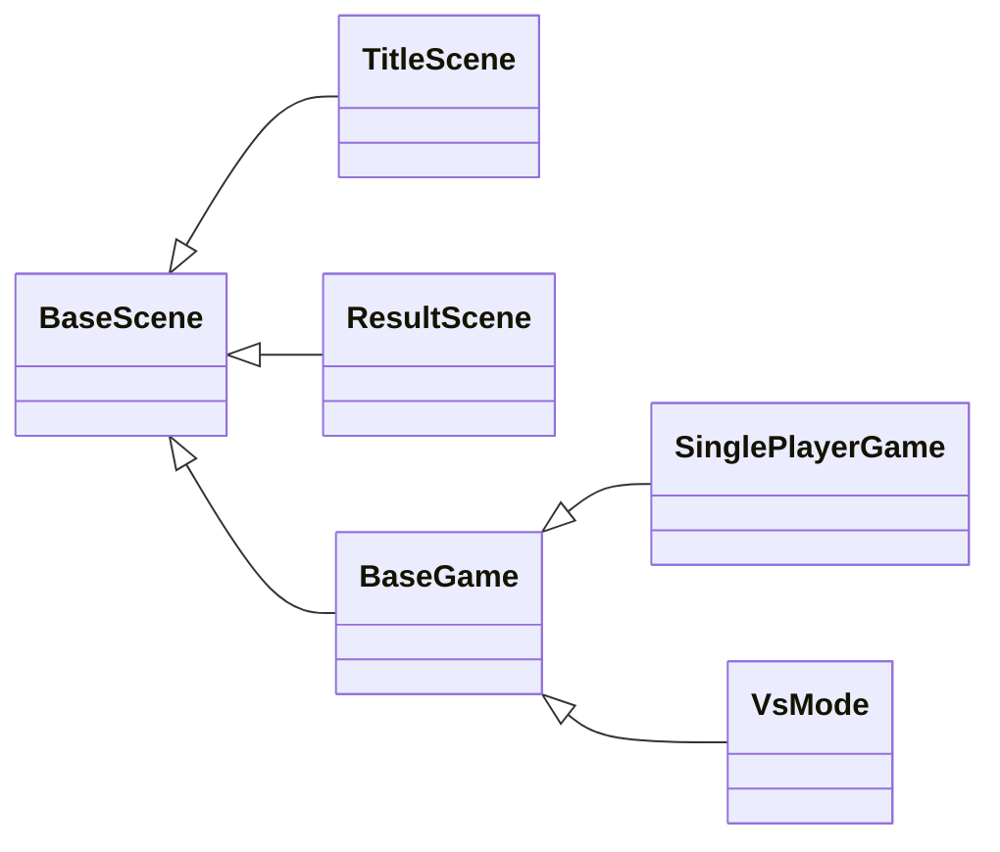

# GemPuzzle

同じ色のジェムを 4 つつなげて消す、連鎖ありの落ち物パズル

<p class="dim">2025.09（2週間） / 個人開発 / C++・DirectX 11</p>

---

# DirectX 11 を初めて使って作った 2D ゲーム

- 同じ色のジェムを 4 つつなげると消え、**連鎖**もできる
- ジェムが溢れるとゲームオーバー
- 制作期間は 2 週間



---

# シーン生成を CreateScene に一本化した

```cpp {2|3-6|7-8|9-13|all}
// src/scene/scene.cpp
static std::unique_ptr<BaseScene> g_CurrentScene;
static std::unique_ptr<BaseScene> CreateScene(SCENE scene)
{
    switch (scene)
    {
    case SCENE_TITLE:  return std::make_unique<TitleScene>();
    case SCENE_GAME:   return std::make_unique<SinglePlayerGame>();
    case SCENE_VS_MODE: {
        auto vs = std::make_unique<VsMode>();
        SetVsModeInstance(vs.get());
        return vs;
    }
    // ...
```

---

# すべてのシーンを同じ型で持つ



もとは関数ポインタの配列で切り替え、対戦モードだけ専用ラッパーが寿命を管理していた。持ち主がシーンごとに違う状態をやめた。

---
layout: two-cols
---

# プレイヤーごとの部品は unique_ptr で持つ

```cpp
// src/scene/VsMode.h
std::unique_ptr<VsModeBlock>   m_Block1;
std::unique_ptr<VsModeBlock>   m_Block2;
std::unique_ptr<VsModeCarrier> m_Carrier1;
std::unique_ptr<VsModeCarrier> m_Carrier2;
std::unique_ptr<VsModeStage>   m_Stage1;
std::unique_ptr<VsModeStage>   m_Stage2;
```

::right::

- `VsMode` が 6 つすべてを所有する
- `VsModeCarrier` は対応する `VsModeStage` を所有せず参照する
- 最初は new / delete で管理していた
- 誰が解放するかが一目で分かる

---

# 振り返り

<v-clicks>

- 1P と 2P で別々に並んだ変数を、プレイヤー単位の構造にまとめたい
- 同じ処理を 2 回書かずに済む
- 人数が変わっても対応できる

</v-clicks>

<p class="dim">詳しくはこの下の本文へ</p>
