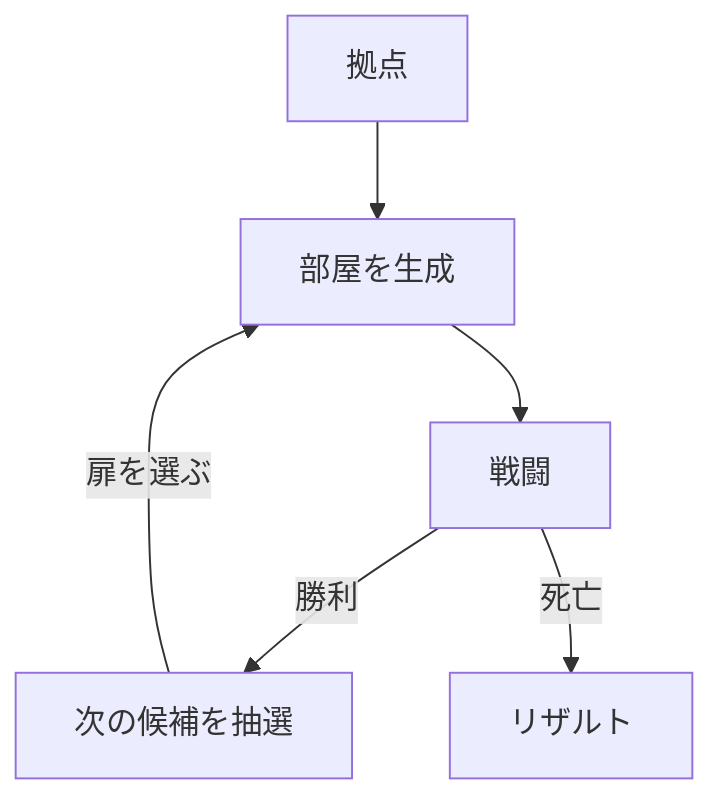
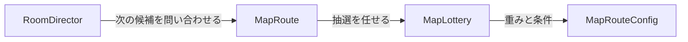

# Hitoriga

左右の手に別々の銃を持つ、見下ろし視点のローグライト・アクション

<p class="dim">2026.08 - 現在 / マップ生成アルゴリズム担当（9人チーム） / Unity・C#</p>

---
layout: two-cols
---

# 全7部屋の「ラン」で、進む扉を選ぶ

<v-clicks>

- 拠点で強化してから出撃する
- 部屋をクリアするたびに、次の部屋の候補が扉として現れる
- どこへ進むかはプレイヤーが選ぶ
- チームは9人。自分は**マップ生成アルゴリズム**担当

</v-clicks>

::right::



---

# 担当は「次の部屋の抽選」と「ランの進行管理」



`RoomDirector` から次の候補を問い合わせられる形にしている

---

# 抽選の決まりごとは5つ

<v-clicks>

- 部屋の種類ごとに重みを付けて抽選
- 一度選んだ種類は候補から外し、扉に同じ種類を重ねない
- 特定の部屋は「このマップまでに何回」と出現を保証
- ボスが選ばれたら、扉はボスの部屋だけ
- 一度出たら出さない種類は、履歴を見て外す

</v-clicks>

---

# 出現の保証は、ぎりぎりになるまで確率に任せる

```csharp {1|3|4-8|all}
if (mapNumber <= _config.GuaranteedByMap && GuaranteedShown < _config.GuaranteedCount)
{
    int mapsLeft = _config.GuaranteedByMap - mapNumber + 1;
    if (_config.GuaranteedCount - GuaranteedShown >= mapsLeft)
    {
        result.Add(guaranteed);
        _candidates.Remove(guaranteed);
    }
}
```

<p class="dim">残りのマップ全部で出しても足りるうちは確率、足りなくなったら確定で入れる</p>

---

# 一度決めた候補は、同じマップ内で引き直さない

```csharp {1-3|5-8|all}
public static IReadOnlyList<RoomKind> NextChoices()
{
    // ...
    if (_choices == null)
    {
        _choices = _lottery.Draw(CurrentMap + 1);
    }
    return _choices;
}
```

<v-clicks>

- 読み込み直しや中断からの再開でも、扉の行き先が変わらない
- `Enter` は、今の候補にない種類なら受け付けない

</v-clicks>

---

# 判断と振り返り

<v-clicks>

- **仕様と実装の分担**: 重み付け・出現の保証・引き直さないことは、プランナーの指示に沿って実装
- **自分で決めたこと**: 重みや保証回数を、コードではなく設定（`MapRouteConfig`）に持たせた
- **理由**: プランナーが自分で調整しやすく、今後の調整もしやすい

</v-clicks>

---

# 詳しくはこの下の本文へ

<p class="dim">抽選のコードと、ランの進行管理の全体を本文で説明しています</p>
