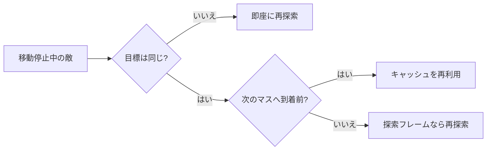

# Sentiment

初めてのチーム制作で作ったタワーディフェンスゲーム

<p class="dim">2025.11 - 2026.03（5ヶ月） / チーム制作・メインプログラマー / C++・DirectX 11・HLSL</p>

---

# 大量の敵を出しても重くならないことを軸にした

- プログラマー 6 人・プランナー 2 人・デザイナー 3 人の計 11 人
- 担当はフレームワーク・経路探索・描画系
- 進級制作展（HAL EVENT WEEK）で**ビジュアル賞**を受賞

---

# 大量の要素を扱うため ECS を採用した

<v-clicks>

- 敵・味方・弾・エフェクトを大量に同時に管理するため、自分で採用を決めた
- エンティティ管理・コンポーネントプール・登録まわりを実装
- システムは AI / Combat / Movement / Pathfinding などカテゴリ別に分ける
- 機能が増えた段階でフォルダとコンポーネントを整理し直した

</v-clicks>

---

# 経路探索は A* を呼ばずに済ませることを優先した

<v-clicks>

- **経路のキャッシュ** — ゴールが同じで次の一歩に未到達なら探索しない
- **再計算のフレーム分散** — 敵ごとに実行フレームをずらす
- **ターゲットが変わったら即再計算** — 古い経路で誤った方向に進ませない
- 壁の破壊・設置でもキャッシュを無効化する

</v-clicks>

---

# 移動が止まった敵はこの順で判定する



---

# 探索そのものも軽くした

```cpp {2-5|6|all}
// src/Core/Systems/Pathfinding/Pathfinding.h
struct PathfinderContext {
    std::priority_queue<Node, std::vector<Node>, std::greater<Node>> openList;
    std::unordered_set<GridCoord, GridCoordHash> closedSet;
    std::unordered_map<GridCoord, float, GridCoordHash> gCostMap;
    std::unordered_map<GridCoord, GridCoord, GridCoordHash> parentMap;
    std::vector<GridCoord> pathBuffer;
    // ...
};
```

作業用コンテナを使い回し、呼び出しごとのヒープ確保をなくした。壁はグリッドのハッシュマップに同期し、ECS を走査せず障害物判定ができる。

---
layout: two-cols
---

# 描画はメモリとシェーダーで効かせた

- 2D アニメーションを **BC7 の DDS 連番**で持つ
- GPU が圧縮されたまま扱えるので、読み込み時のデコードが不要
- 効果範囲と防衛ラインは専用シェーダーで描く
- 色は定数バッファから渡し、1 つのシェーダーで描き分ける

::right::

```hlsl
// 斜線ストライプを作り、位相をずらして流す
float stripeValue = (i.worldPos.x + i.worldPos.z)
                  / stripeWidth + stripePhase;
float pattern     = frac(stripeValue);

// 境界を柔らかくしてジャギーを消す
float edge  = abs(pattern - 0.5f) * 4.0f;
float alpha = 1.0f - smoothstep(0.3f, 0.5f, edge);
```

---

# 壁で道を塞がれないか、置く前に確かめる

- 壁を置けるので、置き方次第で敵の通り道が完全に塞がる
- 仮に置いた状態でゴールまでの経路が残るかを確かめる
- 結果はマスごとにキャッシュする

---

# 判断と振り返り

- **自分で決めたこと**: ECS の採用
- **チームのための整理**: システムのフォルダ分けとコンポーネントの分割
- **結果**: 敵を大量に出しても FPS が出る。実行中のメモリ使用量は 500MB 以下
- **反省点**: デバッグ用の機能をもっと充実させるべきだった

<p class="dim">詳しくはこの下の本文へ</p>
