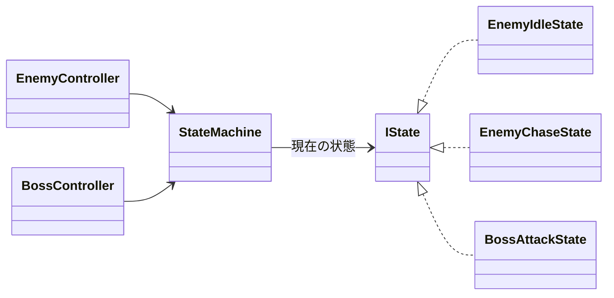
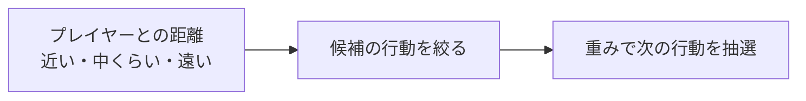

# TriGear

剣・盾・弓を切り替えて戦う、三人称視点の3Dアクション

<p class="dim">2026.04 - 2026.07 / メインプログラマー（10人チーム） / Unity・C#</p>

---

# 3種類の武器をその場で切り替えて戦う

<v-clicks>

- 雑魚敵を倒しながら進み、ステージ最奥の**ボス**の撃破を目指す
- ロックオン、コンボ、ガード、回避、カウンター、必殺攻撃がある
- チームは10人。自分は**メインプログラマー**
- 見せ場は「武器をまたぐコンボ」「敵とボスで共有する状態マシン」「ボスの行動の抽選」

</v-clicks>

---

# 武器をまたぐコンボは、入力時に「派生か何段目か」を決める

```csharp {1-2|4-5|7-10|all}
if (TryProcessWeaponPairGroundTransition(weapon, now, logPrefix))
    return;

if (now - _animComboState.GetLastGroundAttackTime(weapon) > comboResetDelay)
    _animComboState.ResetGroundComboIndex(weapon);

var gIdx = _animComboState.GetGroundComboIndex(weapon);
var stage = gIdx + 1;
PlayGroundAttackAnimation(stage);
_animComboState.SetGroundComboIndex(weapon, (gIdx + 1) % 3);
```

<p class="dim">別の武器へ持ち替えると専用の攻撃に派生。武器ごとの攻撃データと派生のデータは分けて持つ</p>

---

# 状態マシンは軽く作り、敵とボスで共用する



状態が持つのは「入る・毎フレーム・出る」の3つだけ

---

# 追跡中は、探知範囲と攻撃範囲だけを見て遷移する

```csharp {1-6|8-13|all}
// 探知範囲外に出たら Idle へ戻る
if (distSqr > detectionRangeSqr)
{
    _owner.StateMachine.ChangeState(_owner.IdleState);
    return;
}

// 攻撃範囲内かつクールダウン完了で Attack へ
if (distSqr <= attackRangeSqr && _owner.CanAttack)
{
    _owner.StateMachine.ChangeState(_owner.AttackState);
    return;
}
```

<p class="dim">通常の敵は「待機 → 追跡 → 攻撃」を繰り返す</p>

---

# ボスは距離で候補を絞り、重みで抽選する



攻撃は独立した部品で、予兆・当たり判定・演出・待ち時間を部品の中で管理する

---

# 判断と振り返り

<v-clicks>

- **自分で決めたこと**: 状態マシンを軽くして共用。武器の攻撃データと派生データを分離
- **結果**: 新しい雑魚敵やボスを作るのが楽になった
- **進め方**: プランナーが触って調整しやすい形を優先
- **反省**: 攻撃の手触りやカメラワークに、もっとこだわりたかった

</v-clicks>

---

# 詳しくはこの下の本文へ

<p class="dim">コンボの入力処理、状態マシンの構成、ボスの行動の抽選を本文で説明しています</p>
