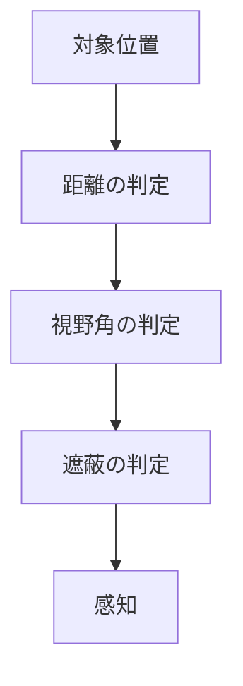

視覚と聴覚で対象を判定し、最後に感知した位置を記憶します。視覚の遮蔽判定は呼び出し側から関数を渡せます。

### 視覚と聴覚

視覚は距離と向きを検査してから遮蔽を問い合わせます。向きは視線と対象方向の内積を、視野の半角の余弦と比較します。遮蔽判定関数がない場合は遮蔽なしとして扱います。



聴覚は最大半径内で音量を距離に応じて線形に減らし、0〜1 に収めます。

```math
I=\operatorname{clamp}\left(L\left(1-\frac{d}{R}\right),0,1\right)
```

`$I$` は聞こえる強さ、`$L$` は音の大きさ、`$d$` は距離、`$R$` は最大半径です。

```cpp
// Engine/AI/Src/Perception.cpp
        const f32 distance = Length(listener - sound.position);
        if (distance > sound.maxRadius)
        {
            return false;
        }

        outIntensity = Saturate(sound.loudness * (1.0f - (distance / sound.maxRadius)));
        return outIntensity > 0.0f;
```

### 記憶の更新

対象 ID ごとに最後の位置、確信度、経過時間を保存します。再び感知すると位置と確信度を更新し、経過時間をゼロに戻します。更新時は確信度を時間に比例して減らし、ゼロ以下になった記憶を削除します。Sandbox の AI デモで視覚と記憶を使用しています。
