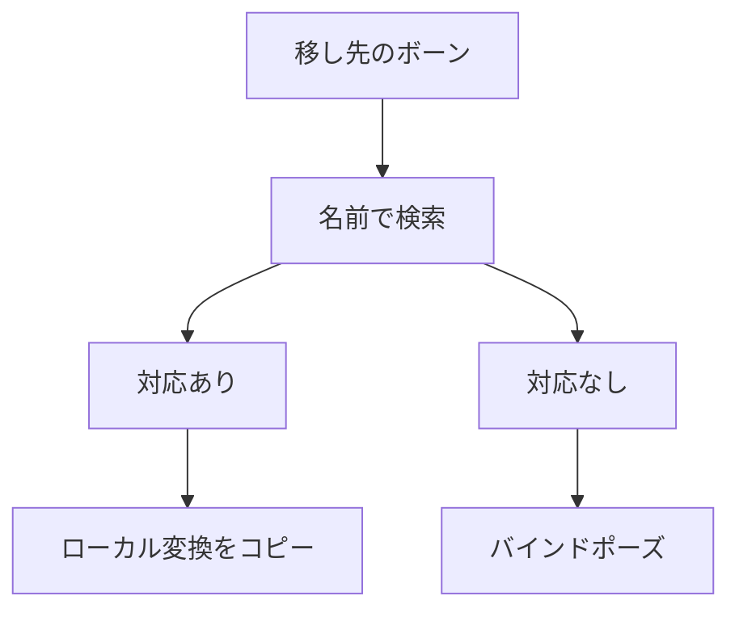

異なるスケルトン間でポーズを移すため、同じ名前のボーンを対応づけます。対応したボーンのローカル変換をコピーします。

### 対応とコピー

移し先の各ボーン名を移し元から探し、インデックスの対応表を作ります。対応がない場合は移し先のバインドポーズを使い、それもなければ単位変換を使います。



```cpp
// Engine/Animation/Src/Retarget.cpp
            if (srcIndex >= 0 && static_cast<usize>(srcIndex) < sourcePose.Size())
            {
                // Matched: copy the source's local transform (identity retarget is exact).
                outTargetPose[t] = sourcePose[static_cast<usize>(srcIndex)];
            }
            else if (t < target.bindPoseLocal.Size())
            {
                // Unmatched: keep the target's bind pose for this bone.
                outTargetPose[t] = target.bindPoseLocal[t];
            }
            else
            {
                outTargetPose[t] = BoneTransform{};
            }
```

Sandbox のキャラクターデモでも別のスケルトンへ適用しています。体格の違いに合わせた移動量の補正はソースのコメントで後回しとされており、現在はコピーのみです。
