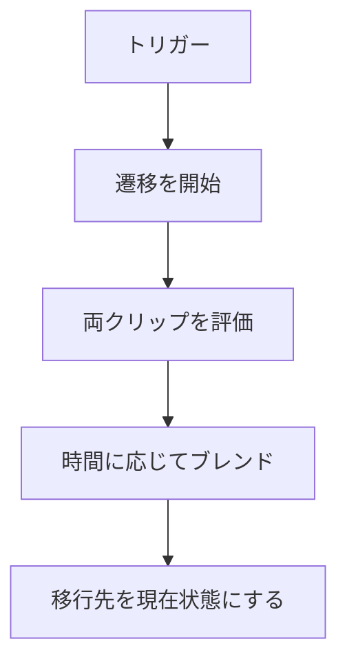

状態にアニメーションクリップを持たせ、名前付きトリガーで遷移するステートマシンです。遷移時間を指定すると、移行元と移行先のポーズを混ぜます。

### 遷移中の評価

現在の状態からトリガーに一致する最初の遷移を開始します。遷移中は両方のクリップの時間を進め、経過時間をブレンド時間で割った重みで補間します。ブレンド時間が 0 以下なら重みは直ちに 1 です。

```cpp
// Engine/Animation/Src/AnimationStateMachine.cpp
        const f32 blendDuration = Max(m_activeTransition.blendDuration, 0.0f);
        const f32 weight = (blendDuration <= 0.0f)
                               ? 1.0f
                               : Saturate(m_transitionTime / blendDuration);

        Pose fromPose;
        Pose toPose;
        SampleStateClip(fromState, m_fromTime, fromPose);
        SampleStateClip(toState, m_toTime, toPose);
        BlendPoses(fromPose, toPose, weight, outPose);
```



Sandbox では idle、walk、run の遷移を設定しています。設計書にあるレイヤーや歩きから走りへの足の位相合わせは、このクラスには入っていません。
