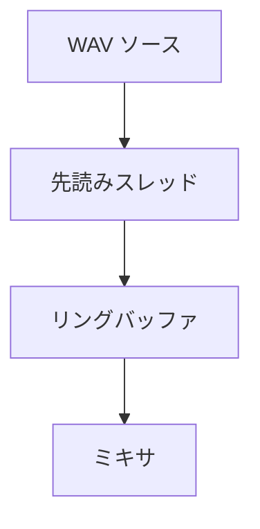

長い音はデコード済み PCM を少しずつ供給する `IAudioStreamSource` から再生します。先読みスレッドがリングバッファに書き込み、ミキサは連続するブロックを読みます。

### 先読みと合成



ミキサは連続領域を取得してまとめて合成するため、サンプルごとの仮想呼び出しは起きません。先読みが追いつかない場合、残りは無音のままにします。終端にも達していればボイスを停止します。

```cpp
// Engine/Audio/Src/AudioMixer.cpp
            const f32* block = nullptr;
            u32 blockFrames = 0;
            if (!pump.PeekBlock(block, blockFrames))
            {
                // 先読みが追いつかない(アンダーラン)。残りは無音のままにして、
                // 終端に達しているならボイスを止める。
                if (pump.IsEnded())
                {
                    voice.active = false;
                }
                return;
            }
```

実装があるのは WAV だけです。Vorbis や Opus のような圧縮コーデックは、追加する前に ADR 004 の方針を見直すと決めています。
