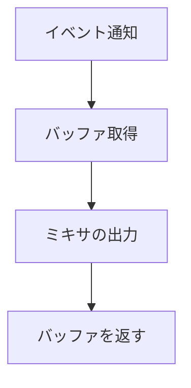

Windows の WASAPI を直接呼び、ミキサの出力をデバイスへ渡します。共有モードを使い、専用スレッドをイベント通知で動かします。

### デバイスへの出力

デバイスの形式を確認して共有ストリームを初期化し、イベントを登録します。通知に応じてデバイスバッファを取得し、ミキサの出力を書き込みます。デバイス形式が PCM でも浮動小数でも扱います。



```cpp
// Engine/Audio/Src/Win32/AudioDeviceWasapi.cpp
            constexpr REFERENCE_TIME kBufferDuration = 10000000 / 20; // 50 ms.
            hr = audioClient->Initialize(AUDCLNT_SHAREMODE_SHARED,
                                         AUDCLNT_STREAMFLAGS_EVENTCALLBACK,
                                         kBufferDuration,
                                         0,
                                         &format.Format,
                                         nullptr);
```

ADR 004 はミキサの自作と WASAPI の直接利用を方針としています。miniaudio のようなライブラリは使っていません。Sandbox でミキサとデバイスを初期化しています。
