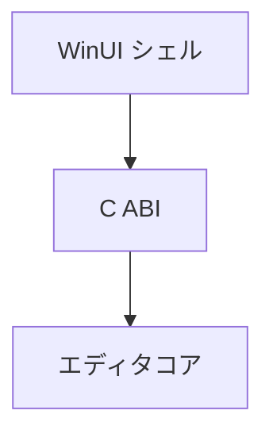

コアを WinUI 3 のシェルへ渡すための境界で、`NexusEditorHost.dll` として出しています（ADR 013）。ヘッダは C99 の型だけで書いています。エンジンは例外と RTTI を切ってビルドしますが、C++/WinRT はそれらを要求し、STL の中身が `_HAS_EXCEPTIONS` で変わるためです。混ぜると実行時に壊れます。

WinUI 3 のシェルは、新しい UI が同等の機能に達した時点で撤去します（ADR 037 の P4）。この ABI の DLL もそのとき不要になります。

### 仕組み

境界に渡す操作は列挙値で表し、シェルは保存や Undo などをコアに伝えます。各エントリは初期化したスレッドから呼ぶ必要があります。



### 実装

```cpp
// Editor/Include/NexusEditor/EditorCoreAbi.h
enum NxEditorCommand
{
    NxEditorCommand_NewScene     = 0,
    NxEditorCommand_AddEntity    = 1,
    NxEditorCommand_DeleteEntity = 2,
    NxEditorCommand_SaveScene    = 3,
    NxEditorCommand_LoadScene    = 4,
    NxEditorCommand_Undo         = 5,
    NxEditorCommand_Redo         = 6,
    NxEditorCommand_Play         = 7,
    NxEditorCommand_Stop         = 8
};
```
