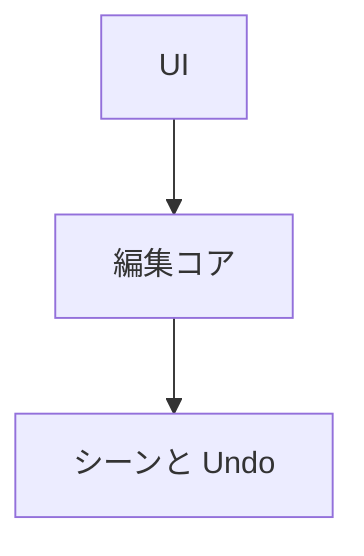

UI に依存しない C++ の静的ライブラリです。シーンの編集、選択、Undo、アセットブラウザ、クックの実行、ビューポートのカメラとギズモ、プレイモードを持ちます。UI を作り直しても、ここはそのまま引き継ぎます。

ウィンドウなしで動く `NexusEditorHeadless` もあり、`--smoke` の検査を CI や自動化から回せます。

### 仕組み

コンポーネントの UI 用登録には取得、追加、削除、コピーの関数が並びます。削除時のスナップショットは登録をたどって作り、Undo で復元する対象を個別に列挙する必要を減らしています。



### 実装

```cpp
// Editor/Src/Core/EditorState.h
    struct EditorComponentUi
    {
        const char* name = nullptr;
        const TypeInfo* typeInfo = nullptr;
        bool (*has)(World& world, Entity entity) = nullptr;
        void* (*getMutable)(World& world, Entity entity) = nullptr;
        // Adds a default-constructed component. No-op when the entity already has one.
        void (*add)(World& world, Entity entity) = nullptr;
        // Removes it. No-op when the entity does not have one.
        void (*remove)(World& world, Entity entity) = nullptr;
        // Copies the component from one entity to another, used by duplicate. Does nothing
        // when the source lacks it.
        void (*copyTo)(World& world, Entity source, Entity destination) = nullptr;
    };
```

### 実行結果

以下は Ryzen 7 9800X3D / Radeon RX 9070 での実行結果です。検査には Vulkan デバイスが使われています。

```text
[Info][LogRHI] Vulkan inline ray query: enabled
[Info][LogRHI] Vulkan storage image write without format: enabled
[Info][LogRHI] Initialized Vulkan device: AMD Radeon RX 9070
[Info][LogEditor] RHI device created on: AMD Radeon RX 9070 (Vulkan)
[Info][LogEditor] 3D viewport ready (3 primitive meshes)
[Info][LogEditor] Scene save/load roundtrip: 8 -> 8 entities [PASS]
[Info][LogEditor] Play In Editor started with 8 2D bodies and 0 3D bodies
[Info][LogEditor] Play In Editor stopped; edit snapshot restored
[Info][LogEditor] Play In Editor smoke movement [PASS]
[Info][LogEditor] Play In Editor smoke restore [PASS]
[Info][LogEditor] Transform gizmo drag [PASS]
[Info][LogEditor] 3D entity creation [PASS]
[Info][LogEditor] 3D entity delete/undo keeps components [PASS]
[Info][LogEditor] 3D viewport picking [PASS]
[Info][LogEditor] 3D entity save/load roundtrip [PASS]
[Info][LogEditor] Smoke test finished after 120 frames
```
