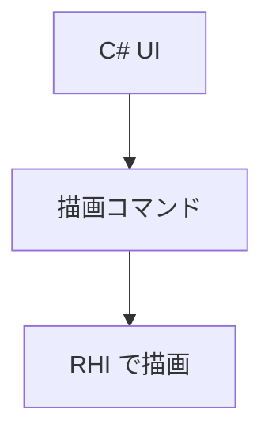

WinUI 3 と XAML をやめ、UI を C# のコードだけで定義する自前のフレームワーク（`Nexus.UI`）と、その上のエディタ（`Nexus.Editor`）に作り替えています（ADR 037）。理由は、変更通知が粗いこと、ビューポートが子ウィンドウで UI と重ねられないこと、シェルの検証が CI に乗らないことでした。

UI は毎フレーム描画コマンドを作って、前のフレームとの差分だけをエンジンの RHI で描きます。入力と描画の裏側を差し替えられるので、ウィンドウなしで UI をテストでき、要素は座標でなく ID で指定できます。

ドッキング、コマンドとショートカット、パネル、仮想化リスト、テキスト編集のコードは入っています。ただし移行は途中で、置き換え先の実行ファイルは `NexusEditorNext` という仮の名前です。

### 仕組み

描画コマンドには矩形、線、画像、テキスト、クリップの操作があります。C# 側が作るコマンドをネイティブ側に渡し、エンジンの描画機能で表示します。



### 実装

```csharp
// Editor/Managed/Nexus.UI/Types.cs
public enum DrawCommandKind : uint
{
    Rect, RoundedRect, Line, Image, Text, PushClip, PopClip
}
[StructLayout(LayoutKind.Sequential)]
public struct DrawCommand
{
    public DrawCommandKind Kind;
    public uint Color;
    public float X;
    public float Y;
    public float W;
    public float H;
    public float Param;
    public int TextOffset;
    public int TextLength;
    public uint Reserved;
    public ulong TextureId;
}
```

<figure>
  
  <figcaption>NexusEditorNext の画面の実行画面です。</figcaption>
</figure>
