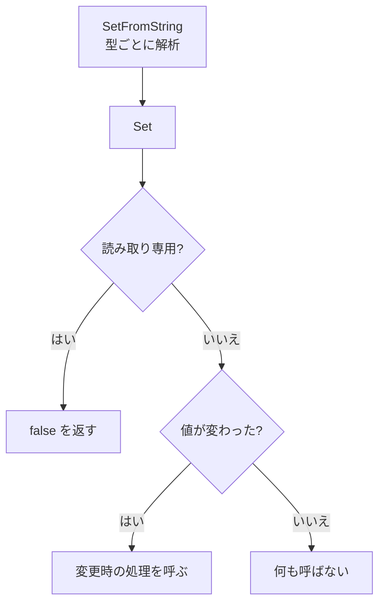

CVar (コンソール変数) は、実行中に確認・変更できる設定値です。bool / i32 / f32 / 文字列の 4 種類で、名前・説明・フラグ (再起動が必要、読み取り専用) を持ちます。値は INI ファイルとコマンドライン引数から適用でき、デバッグコンソールからも確認・変更できます。

### 仕組み

CVar は、グローバルまたは `static` の変数として宣言します。宣言すると自分でレジストリに登録されるので、事前の準備は要りません。名前で探す `FindCVar` と、全部を列挙する `EnumerateCVars` があります。

```cpp
// Sandbox/Main.cpp
static nx::CVar<bool> s_showBanner{"sandbox.showBanner", true, "Draw the demo banner text",
                                   nx::CVarFlags::kNone};
```

値の読み出し (`Get`) は、bool / i32 / f32 では relaxed の atomic ロードです。ロックなしで、ホットパスから読めます。変更と登録はメインスレッド専用です。`Set` は、読み取り専用なら `false` を返して何もしません。値が変わったときだけ、変更時のコールバックを呼びます。

```cpp
// Engine/Foundation/Include/Nexus/Foundation/Config/CVar.h
bool Set(T newValue)
{
    if (IsReadOnly())
    {
        return false;
    }

    const T oldValue = Get();
    if (Traits::Equal(oldValue, newValue))
    {
        return true;
    }

    Traits::Store(m_value, newValue);
    if (m_onChange != nullptr)
    {
        m_onChange(*this);
    }
    return true;
}
```

文字列から値を変えるときの流れです。



### 実装

文字列からの設定は、`SetFromString` が型ごとに構文解析して `Set` を呼びます。INI からの適用は、`[section]` の `key = value` を `section.key` という名前に直して探します。コマンドラインは、`-名前=値` の形の引数だけを拾います。

```cpp
// Engine/Foundation/Src/Config/CVar.cpp
StringView  option(argument + 1);
const usize equals = option.FindChar('=');
if (equals == StringView::kNpos || equals == 0u)
{
    continue;
}

const StringView name  = option.Substr(0, equals);
const StringView value = option.Substr(equals + 1u);
```

どちらも、適用できた件数を返します。

### 限界

- デバッグコンソール (Runtime の `Console`) が使っているのは、`FindCVar` と `EnumerateCVars` です。`ApplyIniToCVars` と `ApplyCommandLineToCVars` を呼んでいるのは、Foundation のテストだけで、Sandbox、Samples、Editor、Runtime、Renderer の起動処理からは呼ばれていません (検索して確認しました)。
- フラグ `kRequiresRestart` は、`CVarFlags` に定義がありますが、この値を参照するコードは、ソース全体に見当たりません (定義だけです)。
