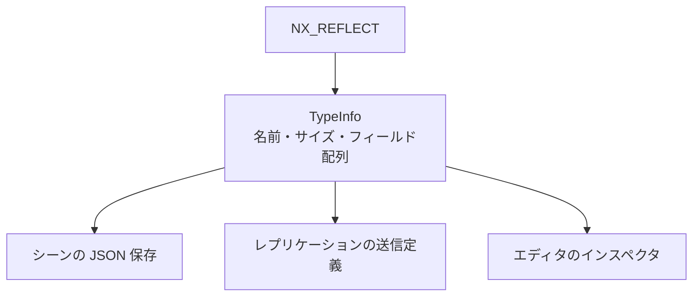

`NX_REFLECT` でフィールドを登録し、型ごとの `TypeInfo` を引けるようにしています。RTTI を使わないので、型情報は登録したものだけです。

### 仕組み

この情報を 3 か所が共有しています。シーンの JSON 保存、ネットワークのレプリケーション (フィールドの送信定義をここから作ります)、エディタのインスペクタです。同じ定義から読み書きするので、フィールドを足したときに、3 か所を別々に直す必要がありません。

1 つの登録が、3 か所の入力になります。



登録は、型の外側に 1 行書きます。たとえば `LocalTransform` は次のとおりです。

```cpp
// Engine/Scene/Include/Nexus/Scene/SceneSerializer.h
NX_REFLECT(nx::LocalTransform, position, rotation, scale)
```

`TypeInfo` は、型の名前、サイズ、アラインメント、フィールドの配列を持ちます。フィールドは、名前、種類 (`FieldKind`)、構造体の先頭からのオフセットを持ちます。

```cpp
// Engine/Foundation/Include/Nexus/Foundation/Reflect/TypeInfo.h
struct FieldInfo
{
    const char*     name       = nullptr;
    StringId        nameId     = StringId::kInvalid;
    FieldKind       kind       = FieldKind::kBool;
    usize           offset     = 0;
    const TypeInfo* structType = nullptr;
};
```

### 実装

`NX_REFLECT` は、`TypeInfoResolver<Type>` の特殊化を生成するマクロです。フィールド名から `offsetof` でオフセットを求め、`decltype` でフィールドの種類を決めます。対応する種類は、bool、i32、u32、i64、u64、f32、f64、Vec2、Vec3、Vec4、Quat、String、そして入れ子の構造体です。これ以外の型は `static_assert` でコンパイルエラーになります。フィールド数は 32 個までです。

型情報は、型名から `StringId` を作って登録され、`FindTypeInfo` で名前から引けます。

### 設計判断

RTTI を使わず、登録したものだけを型情報にする方針です。コンポーネントはロジックを持たない構造体にする方針 (ADR 003) と合わせて、反射が早い段階で必要になるため、Foundation に最初から組み込みました。

### 限界

- `NX_REFLECT` は `TypeInfoResolver` の明示的な特殊化です。特殊化が見えない翻訳単位で `GetTypeInfo<T>()` を呼ぶと、主テンプレートが選ばれて、黙って `nullptr` が返ります。ADR 034 はこれを罠として挙げ、型の定義と反射を同じヘッダに置く、登録時にコンパイルエラーにする、という対策を提案しています。ただし ADR 034 の状態は「提案」で、この対策は入っていません。実際に `LocalTransform` の反射は `Transform.h` ではなく `SceneSerializer.h` にあります。
- 列挙型のフィールドは、`FieldKind` にありません。`static_assert` に引っかかります。ADR 034 は、列挙を `u32` で持つ規約を提案しています。
