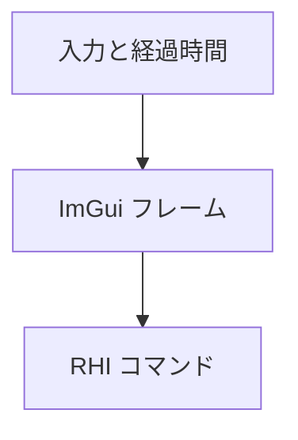

Dear ImGui を、自作の RHI の上で動かすバックエンドです。公式のバックエンドを使わず自前で書いたのは、DirectX 12 と Vulkan の両対応という RHI の一貫性を、迂回して崩さないためです（ADR 012）。

用途はインゲーム UI とデバッグオーバーレイで、エディタの UI は対象外です。エディタは当初 ImGui で作っていましたが、現在は C# の自前 UI へ移行しています（ADR 012、ADR 037）。

### 仕組み

初期化には描画先フォーマットと頂点・ピクセルシェーダを渡します。フレーム開始時にウィンドウと経過時間を渡し、描画には RHI のコマンドリストを使います。日本語フォントを統合できない場合、保証されるのは ASCII のフォールバックです。



### 実装

```cpp
// Engine/ImGui/Include/Nexus/ImGui/ImGuiBackend.h
        Result<void, rhi::RHIError> Initialize(rhi::IDevice& device, rhi::Format colorFormat,
                                               rhi::ShaderBlob vertexShader,
                                               rhi::ShaderBlob pixelShader);
        void Shutdown(rhi::IDevice& device);
        void NewFrame(const Window& window, f32 deltaSeconds);
        void Render(rhi::IDevice& device, rhi::ICommandList& cmd);

        // Reports whether a Japanese font was merged into the default ImGui font atlas.
        // When false, the backend remains usable but only the ASCII fallback is guaranteed.
        bool HasJapaneseGlyphs() const { return m_hasJapaneseGlyphs; }
```

<figure>
  
  <figcaption>Sandbox の Controls と Performance パネルの実行画面です。</figcaption>
</figure>
