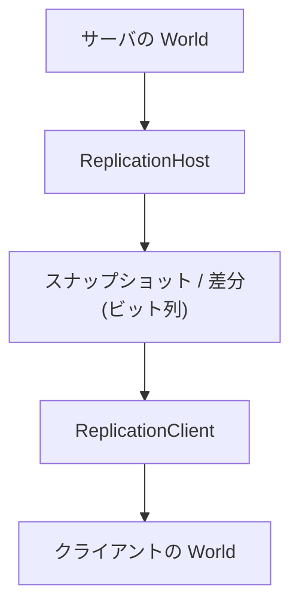

サーバの ECS(エンティティとコンポーネントでワールドを表す仕組み)の状態を、クライアントのワールドに写します。送る項目はコンポーネントのリフレクション情報から作り、ビット単位に詰めるので、手で送受信のコードを書く必要がありません。

### 仕組み



`ReplicationHost` に、複製したいコンポーネントの型と、複製するエンティティ(サーバが振る安定した ID `NetEntityId` つき)を登録します。送るパケットは 2 種類です。

- スナップショット: 登録した全エンティティ・全コンポーネントの完全な状態。クライアントはこれでワールドを作り直し、サーバにないエンティティは消します。
- 差分: 前回のスナップショットまたは差分との違いだけ。エンティティの追加と削除、変わったフィールドを送ります。

差分の基準は `ReplicationHost` が 1 つだけ持ちます。スナップショットを作ると基準がその状態に置き換わり、差分を作るたびに基準が更新されます。

コンポーネントごとの送信定義 `ReplicationSchema` は、`MakeSchemaFromReflection` がリフレクションの型情報から作ります。対応する型は bool、整数、浮動小数点、`Vec2`/`Vec3`/`Vec4`、`Quat` です。文字列と入れ子の構造体は対象外で、定義から外れます。

差分では、フィールドごとに 1 ビットの「変わったか」フラグを置き、変わったものだけ値を続けます。比較は元の値のバイト列で行います。

```cpp
// Engine/Network/Src/Replication/Replication.cpp
        for (usize fieldIndex = 0; fieldIndex < schema.fields.Size(); ++fieldIndex)
        {
            const ReplicatedField& field = schema.fields[fieldIndex];
            const bool changed = FieldChanged(field, baseline, current);
            writer.WriteBool(changed);
            if (changed)
            {
                WriteField(writer, field, current);
            }
        }
```

### 量子化

浮動小数点のフィールドには、範囲 `[min, max]` と bit 数 `b` を指定して量子化できます。書き込みは範囲に丸めたあと、`b` ビットの整数にします。

```math
q = \left\lfloor \frac{\operatorname{clamp}(v,\ \min,\ \max) - \min}{\max - \min}\,(2^{b}-1) + \tfrac{1}{2} \right\rfloor,\qquad
v' = \min + \frac{q}{2^{b}-1}\,(\max - \min)
```

`v` は元の値、`q` は送る整数、`v'` は復元した値です。丸めの幅から、誤差は最大で `(max - min) / (2(2^b - 1))` です。たとえば範囲が -100〜100、16 ビットなら約 0.0015 です。ビットは LSB 先頭で詰め、バイト順は実行環境に依存しません。

```cpp
// Engine/Network/Include/Nexus/Network/BitStream.h
            const f64 maxQuantized = MaxQuantizedValue(bits);
            const f32 clamped = Clamp(value, min, max);
            const f64 normalized =
                static_cast<f64>(clamped - min) / static_cast<f64>(max - min);
            f64 rounded = std::floor(normalized * maxQuantized + 0.5);
```

### 設計判断

ADR 006 は、レプリケーションを ECS と統合し、対象をリフレクション情報から宣言して、スナップショットと差分で同期する方針を定めています。そのためリフレクションとシリアライズの設計は、差分の検出とビット単位の書き込みを最初から想定しています。

サーバとクライアントは、同じコンポーネントを同じ順序で登録する約束です。型を区別する `typeId` はワイヤ上の目印になります。サーバとクライアントで `Entity` の世代つきハンドルは一致しないので、エンティティは `NetEntityId` で対応づけます。

### 限界

- 量子化の設定は `ReplicatedField` に持てますが、`MakeSchemaFromReflection` は常に量子化なしで定義を作ります。ソースを検索した範囲では、量子化を有効にする呼び出しはありません。
- 関心領域による絞り込み(interest management)は、ソースのコメントで後の段階とされています。
- ADR 006 はオブジェクトごとの権限(authority)モデルを構想に含めていますが、Network のソースに該当する実装は見当たりません。
- 文字列と入れ子の構造体は複製できません。
- 差分の基準はクライアントごとではなく 1 つです。クライアントからの確認応答に基づく基準の選択も後の段階です。
