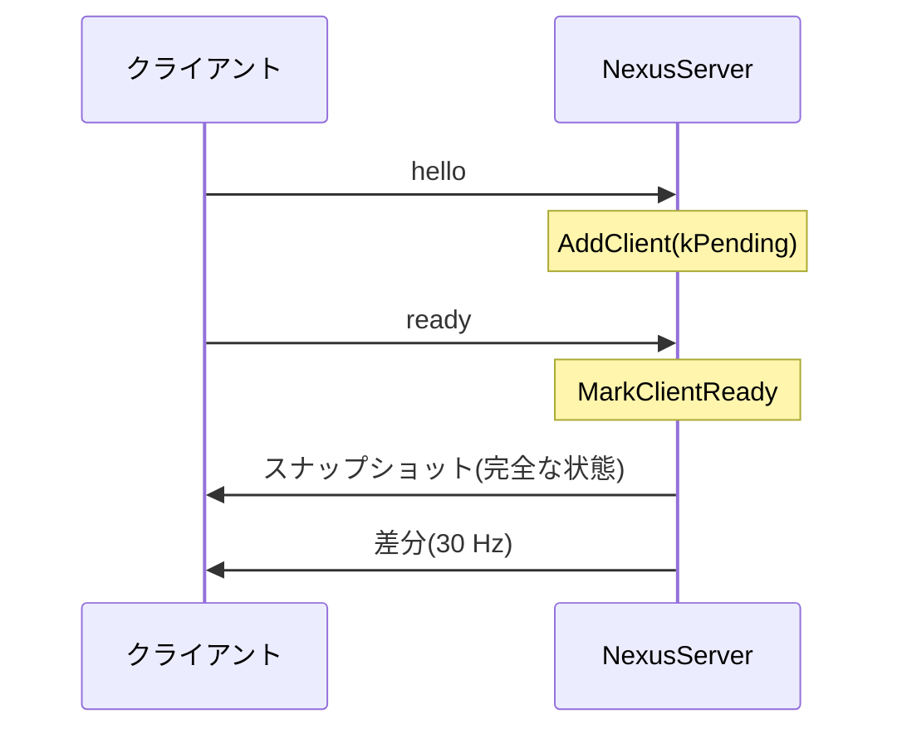

サーバがクライアントの参加状態を管理し、いつ誰にどの状態を送るかを決める層です。アセットを読み込み中のクライアントに、受け取れない帯域を使わないようにします。ロビーとマッチメイキングの参照実装も同じモジュールにあります。

### 参加と送信

`ServerSession` はクライアントごとに「準備完了か」と「スナップショットがまだ要るか」を持ちます。参加直後の状態を `kPending` にすると、`MarkClientReady` が呼ばれるまで、そのクライアントには何も送りません。



`NexusServer` は、未知のエンドポイントから最初のデータグラムが届くと `kPending` で登録します。`ready` を示すバイトを受け取ると準備完了にします。クライアントは、サーバが黙っている間は `ready` を送り直します(Sandbox は 0.25 秒間隔)。そのため準備完了への切り替えは、何度呼ばれても結果が変わらず、ログも出ません。

`Tick` は、準備完了のクライアントだけに送ります。新しく準備完了になったクライアントにはスナップショットを、それ以外には差分を送ります。同じティックに両方が要るときは、差分を先に作ります。スナップショットを作ると差分の基準が置き換わるので、この順にすれば既存クライアントへの差分は直前の基準との差になります。

### 送信頻度

スナップショット(差分)の頻度は `SetSnapshotHz` で設定でき、`NexusServer` は 30 Hz にしています。経過時間を溜めて、1 周期ぶん溜まったら 1 回送ります。

```math
a \leftarrow a + \Delta t,\qquad
\text{送信} \iff a \ge \tfrac{1}{f},\qquad
a \leftarrow a - \tfrac{1}{f}
```

`a` は溜めた時間、`f` は設定した頻度です。溜める量は 2 周期分までに制限します。送信後の余りが 1 周期以上に残るとき(2 周期以上止まったとき)は 0 に捨てます。余りを持ち越すのは、`Δt` が周期で割り切れない場合に平均の送信レートが下がるのを避けるためで、捨てるのは停止後にパケットがまとめて飛ぶのを避けるためです。ソースのコメントに、144 Hz で呼ぶと 30 Hz でなく 28.8 Hz になる例が書かれています。

```cpp
// Engine/Network/Src/Session/NetworkSession.cpp
                m_snapshotAccumulator =
                    deltaDue ? m_snapshotAccumulator - snapshotInterval : 0.0f;
                if (m_snapshotAccumulator < 0.0f || m_snapshotAccumulator >= snapshotInterval)
                {
                    m_snapshotAccumulator = 0.0f;
                }
```

### ロビーとマッチメイキング

`LobbyService` は、参加コード(7 文字までの文字列)つきのロビーを作り、コードで参加し、準備完了を切り替え、ホストが開始する流れをメモリ上で扱います。`Matchmaker` は、プレイヤーのチケット(プレイリスト、スキル値、受付時刻)を受け付け、`Update` で人数とスキル差の上限を指定して組を作ります。結果にはサーバの接続先(`ServerEndpoint`)が付きます。どちらもヘッダに「参照実装」と書かれています。

### 設計判断

ADR 006 は、セッション層にマッチメイキング、ロビー、セッション管理のクライアント API と、参照実装の専用サーバを置く構成を定めています。

### 限界

- `LobbyService` と `Matchmaker` は、`NexusServer` にも Sandbox にも組み込まれていません。ソースのコメントでも、トランスポートやサーバとの結合、NAT 越え、リレーは後の作業とされています。
- クライアントからの入力と、差分の基準を確認応答で選ぶ処理は、ソースのコメントで後の作業です。`OnReceiveFromClient` は今は何もしません。
- `ClientSession` は届いたパケットの種類を見て、スナップショットまたは差分を `ReplicationClient` に渡します。クライアントからサーバへ送る口(`SendToServer`)は、単に下位の送り口に流します。
