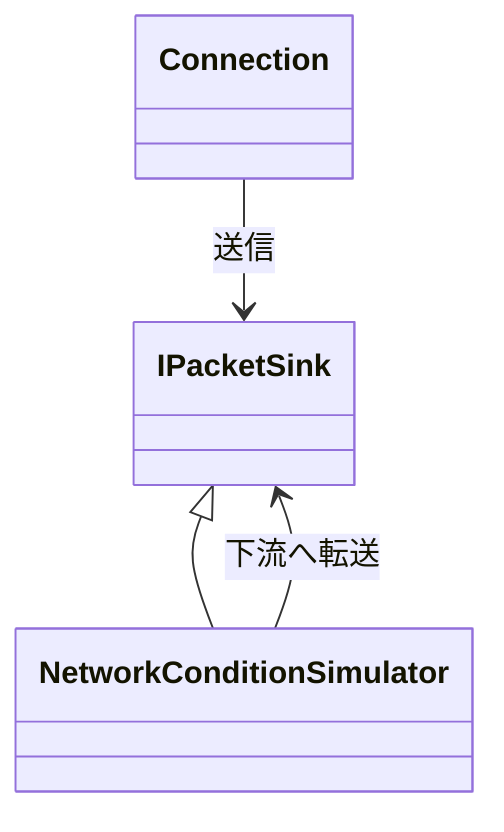

ゲームの通信は、遅れて届く、順序が入れ替わる、届かない、という UDP の性質をそのまま受けます。`Connection` は UDP のデータグラムの上に、チャンネルごとに配送の性質を選べる接続を載せます。再送、分割、接続の維持もここで持ちます。

### 仕組み

メッセージは `SendMessage(channel, delivery, data, size)` で送ります。`delivery` は 3 種類です。

- `kUnreliable`: 再送も順序づけもしません。
- `kUnreliableSequenced`: 再送はしません。チャンネルごとに最後に受け取った番号より新しいものだけを渡し、古いものは捨てます。
- `kReliableOrdered`: 届くまで再送し、チャンネルごとに送った順で渡します。

MTU は既定で 1200 バイトです。パケットヘッダが 20 バイト、メッセージヘッダが 12 バイトなので、1 つの断片に入る本体は最大 1168 バイトになります。これを超えるメッセージは断片に分け、受信側で組み直します。

パケットには 16 ビットの連番と、確認応答として `ack` と 32 ビットの `ackBits` を載せます。`ackBits` は `ack` から遡った 32 パケット分の受信有無です。確認応答を受けたパケットに載せた信頼配送のメッセージは、再送待ちから外れます。



`IPacketSink` は「データグラムを送る先」を表す小さなインターフェースです。`Connection` はソケットを直接持たないので、間に `NetworkConditionSimulator` を挟めます。これは損失、重複、順序入れ替え、遅延を確率で起こす疑似回線で、シード付きの乱数で動くため、同じ条件を再現できます。

### 再送間隔

再送までの待ち時間は、確認応答を受けるたびに往復時間(RTT)の推定から更新します。

```math
\mathrm{srtt} \leftarrow \mathrm{srtt} + \tfrac{1}{8}(s - \mathrm{srtt}),\quad
\mathrm{var} \leftarrow \mathrm{var} + \tfrac{1}{4}(|s - \mathrm{srtt}| - \mathrm{var}),\quad
\mathrm{rto} = \mathrm{srtt} + \max(0.01,\ 4\,\mathrm{var})
```

`s` は確認応答までにかかった時間の標本です。`var` の更新は `srtt` を更新する前の差を使います。`rto` は `max(resendDelaySeconds, timeoutSeconds / 2)` で頭打ちにし、実際の再送間隔は `max(resendDelaySeconds, rto)` です。

```cpp
// Engine/Network/Src/Transport/Transport.cpp
        const f32 delta = sampleSeconds - m_smoothedRtt;
        const f32 absDelta = (delta < 0.0f) ? -delta : delta;
        m_smoothedRtt += delta * 0.125f;
        m_rttVariance += (absDelta - m_rttVariance) * 0.25f;
        m_resendTimeout = m_smoothedRtt + MaxF32(0.01f, m_rttVariance * 4.0f);
        const f32 maxTimeout = MaxF32(m_config.resendDelaySeconds, m_config.timeoutSeconds * 0.5f);
        if (m_resendTimeout > maxTimeout)
        {
            m_resendTimeout = maxTimeout;
        }
```

### 設定

```cpp
// Engine/Network/Include/Nexus/Network/Transport.h
    struct ConnectionConfig
    {
        u32 connectionId = 1;
        u32 protocolVersion = 1;
        u32 mtu = kDefaultTransportMtu;
        f32 resendDelaySeconds = 0.08f;
        f32 heartbeatSeconds = 0.10f;
        f32 timeoutSeconds = 3.0f;
    };
```

接続の最初は `kConnecting` で、ハートビートの間隔ごとにハンドシェイクを送ります。受信が `timeoutSeconds` 途切れると `kDisconnected` になり、理由は `kTimeout` です。プロトコルのバージョンが合わないときは `kProtocolMismatch` で切れます。送るものがないときも、ハートビートの間隔でパケットを送って接続を保ちます。

### 限界

- 暗号化はありません。パケットは平文で、ソースにも「libsodium の統合まで入れない」という注記があります。ADR 004 は暗号に libsodium を使う例外を認めていますが、組み込んでいません。
- ADR 006 は輻輳制御もトランスポート層の範囲に挙げていますが、`Connection` に輻輳制御は見当たりません。
- 現在 `Connection` を使っているのは Network のテストだけです。`NexusServer` と Sandbox は `Transport.h` を取り込んでいますが、`Connection` は作らず、UDP ソケットでデータグラムを直接やり取りしています。
- `ReliableChannel` という別クラスもあります。連番と `ackBits` による再送と順序受信を持つ単体の実装で、`Connection` からは使われておらず、Network の外からも呼ばれていません。
