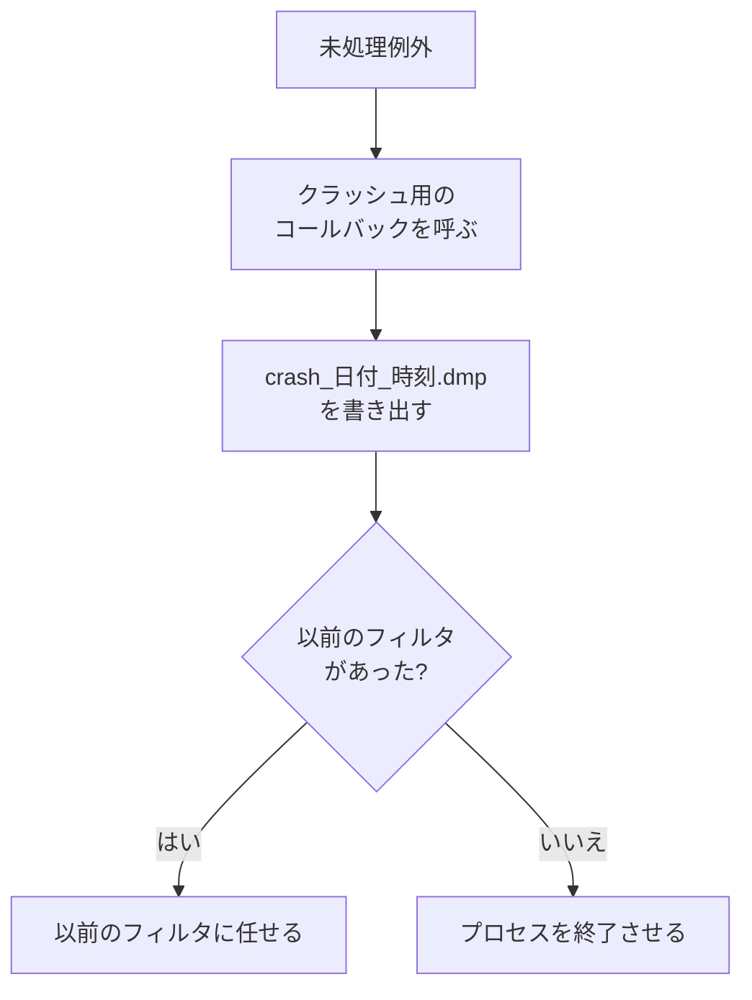

落ちたときに、あとで原因を調べるための記録(ミニダンプ)を残します。開発中の確認や QA、配布後のクラッシュで、再現できなくても手がかりが残るようにするためです。

### 仕組み

`InstallCrashHandler(dumpDirectory)` が、Windows の未処理例外のフィルタを登録します。2 回呼んでも 2 回目は何もしません。出力先のフォルダは、なければ作ります(失敗しても続行します)。

例外が処理されないまま届くと、フィルタは次の順に動きます。



ファイル名は `crash_YYYYMMDD_HHMMSS.dmp` の形で、ローカル時刻です。種類は `MiniDumpNormal` で、例外の情報を付けて書きます。

```cpp
// Engine/Platform/Src/Win32/Win32CrashHandler.cpp
            // Give the app a chance to flush logs / attach replay before we dump.
            if (g_crashCallback != nullptr)
            {
                g_crashCallback(g_crashUser);
            }

            SYSTEMTIME now = {};
            GetLocalTime(&now);
```

`SetCrashCallback` で登録したコールバックは、ダンプを書く前に呼ばれます。ログの履歴を書き出す、といった使い方を想定しています。落ちた直後の不安定な状態で動くので、短く、他に依存しない処理にする前提です。

`WriteMiniDump(path)` は、落とさずにその場でダンプを取ります。手動の採取と、ダンプを書く経路のテストに使えます。

### アプリでの有効化

`Application` は、設定の `installCrashHandler`(既定は有効)が真なら、初期化の最初のほうで `InstallCrashHandler` を呼びます。出力先の既定は `out_crash_dumps` です。デモやサンプルは、共通の起動処理を通るだけで、この仕組みが働きます。

### 限界

- `SetCrashCallback` を呼んでいるのは Platform のテストだけです。`Application` や Sandbox は、コールバックを登録していません。ログの書き出しなどは、いまはダンプの前に行われません。
- 種類は `MiniDumpNormal` だけです。ダンプの種類を変える設定はありません。
- 対応は Windows だけです。Windows 以外向けの関数は空の実装で、`WriteMiniDump` は `false` を返します。
- ダンプを解析する側の仕組み(シンボルの管理や、自動の収集・送信)は、Platform にはありません。
