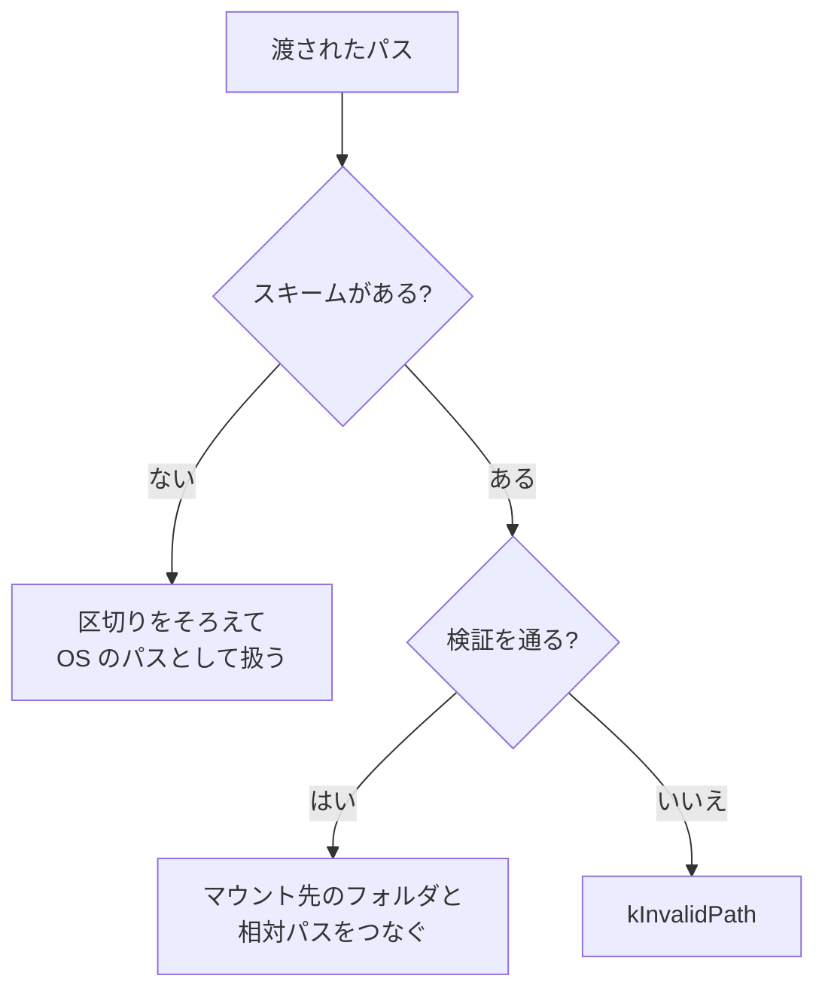

ファイルの読み書きを、OS のパスに直接頼らず、名前のついた「マウント」を通して行います。ゲームのコードは `shaders://` で始まるパスを渡すだけで済み、実際のフォルダの場所は起動時に一度決めれば足ります。

### 仕組み

`Mount("shaders", "C:/.../Shaders")` のように、スキーム名とディスク上のフォルダを結びつけます。同じスキーム名でもう一度マウントすると、フォルダが置き換わります。

`Resolve` は、パスを OS のパスに直します。

- `スキーム://` で始まるパス: マウントの先を探し、先頭のフォルダと相対パスをつなぎます。区切りの `\` は `/` にそろえます。
- スキームのないパス: 区切りをそろえるだけで、そのまま OS のパスとして扱います。
- 次の場合は `kInvalidPath` を返します: 空のパス、マウントされていないスキーム、スキームが 31 文字を超える、相対パスに `..` の段が含まれる、結果が出力先の大きさに入らない。

`Resolve` の判定をまとめると次のとおりです。



相対パスの `..` を拒否するので、マウントしたフォルダの外へ抜けるパスは作れません。パスは UTF-8 で受け取り、OS へは UTF-16 に変換して渡します。

```cpp
// Engine/Platform/Src/Win32/Win32FileSystem.cpp
        const char* relativePath = separator + 3;
        if (ContainsParentSegment(relativePath))
        {
            return Result<void, FileError>::Err(FileError::kInvalidPath);
        }
```

読み書きは同期 I/O です。

- `ReadEntireFile(path, allocator)`: ファイル全体を、渡したアロケータで確保したバッファに読みます。結果の `FileBlob` は `FreeFileBlob` で解放します。
- `WriteEntireFile`: 全体を書き、すでにあるファイルは作り直します。
- `Exists`: 存在の確認です。
- エラーは `kNotFound`、`kAccessDenied`、`kInvalidPath`、`kIoFailed`、`kOutOfMemory` の 5 種類です。

### ホットリロードのための更新時刻

`LastWriteTime` は、ファイルの最終更新時刻を 64 ビットの値で返します。値に意味があるのは「前回と同じか違うか」だけで、ヘッダにもそう書かれています。リソース管理は、この値を定期的に読み、前回と違えば再読み込みします。ファイルの変更を OS から通知してもらうのではなく、ポーリングで見つける作りです。

### 使われ方

Sandbox と RHI の自己テスト(`Tools/RhiSelfTest`)は、`shaders` をマウントしてシェーダーを読みます。Sandbox にはクック済みアセットを扱う箇所があり、そこでは `cooked` のスキームをマウントしています。

### 限界

- ファイルの変更監視、メモリマップ、非同期 I/O は、ヘッダで「後の段階」とされています。
- マウントは起動時に登録する前提で、`Mount` と `Resolve` を並行して呼んでも保護されません。先にマウントを済ませ、そのあとは読み取り専用で使う約束です。
- `WriteEntireFile` は、親のフォルダを作りません。フォルダがなければ失敗します。
- マウントの優先順位や、複数のフォルダを重ねる仕組み(上書き用の層など)はありません。1 つのスキームに 1 つのフォルダです。
- Windows の実装だけです。
