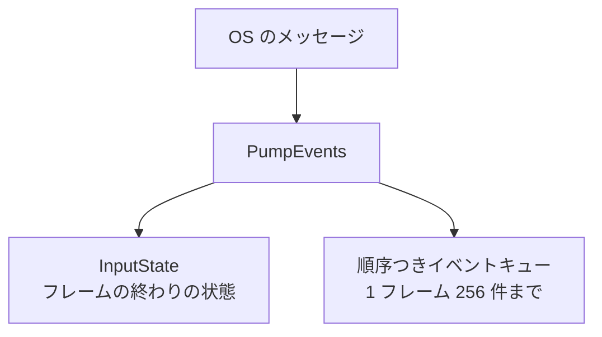

OS のウィンドウを作り、メッセージを処理して、入力と大きさの変化をゲームのコードへ渡します。Win32 を直接扱い、それ以外の OS には対応しません(ADR 001)。

### 仕組み

`Window::Create` でトップレベルのウィンドウを作ります。タイトル、幅、高さを渡し、失敗したときは理由(`WindowError`)を返します。フレームごとに `PumpEvents` を呼ぶと、溜まった OS のメッセージを処理して、入力状態を更新し、クライアント領域の大きさを読み直します。

`PumpEvents` は、メッセージを処理したあとに `GetClientRect` で大きさを問い合わせます。最小化の状態で起動されると、`WM_SIZE` がまだ届いていないのに、実際の領域がすでに 0×0 になっていることがあります。このとき作成時の大きさを返し続けないためです。

```cpp
// Engine/Platform/Src/Win32/Win32Window.cpp
        const HWND hwnd = static_cast<HWND>(m_handle);
        RECT clientRect{};
        if (hwnd != nullptr && GetClientRect(hwnd, &clientRect) != FALSE)
        {
            m_width = static_cast<u32>(std::max<LONG>(0, clientRect.right - clientRect.left));
            m_height = static_cast<u32>(std::max<LONG>(0, clientRect.bottom - clientRect.top));
        }
```

`WaitForEvents` は、メッセージが来るか指定時間(既定 16 ミリ秒)が過ぎるまで待ちます。メッセージの処理はしません。最小化中のアプリが CPU を使い切らずに、メッセージだけを待つ用途です。

DPI は、ウィンドウがプロセスごとではなくモニターごとの DPI に対応しているときだけ、`WM_DPICHANGED` で倍率(`DpiScale`、96 DPI を 1.0 とする)を更新し、OS が提案した大きさにウィンドウを変えます。

### 順序つきの入力イベント

`InputState` は、フレームの終わりの状態しか持ちません。同じフレームに押して離したキーの順序や、マウスが動いた途中の座標は残りません。そこで `Window` は、キーの上げ下げ、マウスの移動とボタン、ホイール、文字入力、IME の各イベントを、起きた順に 1 本のキュー(`InputEvents()`)にも入れます。

キューは 1 フレームに 256 件までです。あふれたときは、新しく来たイベントを捨てて、すでに入っている分の順序を保ちます。捨てた数は `InputEventsDropped` で取れます。

1 回の `PumpEvents` で、入力は次の 2 つの形に分かれて渡ります。



### IME(日本語入力)

`SetImeEventsEnabled(true)` にしたウィンドウだけが、`WM_IME_*` を自前で処理します。変換中の文字列は `kImeComposition`、確定は `kImeCommit`、取り消しは `kImeCancel` のイベントとして、文字列(UTF-16、最大 8192 要素)と一緒に届きます。候補ウィンドウの位置は `SetImeCandidatePosition` で OS に伝えます。既定では OS の処理に任せます。CI で実際の IME は動かせないので、`InjectImeEvent` で同じイベントを注入できます。

これらは、エディタの UI を C# の自前フレームワークで作り直すために足しました(ADR 037)。日本語入力は、その移行の完了条件に入っています。

### 子ウィンドウと外部のメッセージループ

`CreateChild` は、親のウィンドウの中に子ウィンドウを作ります。`NewInputFrame` は、メッセージを処理せずに入力のフレームだけ進めます。メッセージループを別の仕組み(WinUI 3 の XAML など)が持っていて、`PumpEvents` を呼ぶとその仕組みのメッセージを奪ってしまう場合に使います。エディタのコードがこの 2 つを呼んでいます。

### 限界

- ウィンドウモードの切り替え(全画面など)と、複数モニターの列挙は、ヘッダで今回の範囲外と書かれています。
- Win32 の実装だけです。Linux の実装は、もともとなく、ADR 001 の改訂で対象から外れました。
