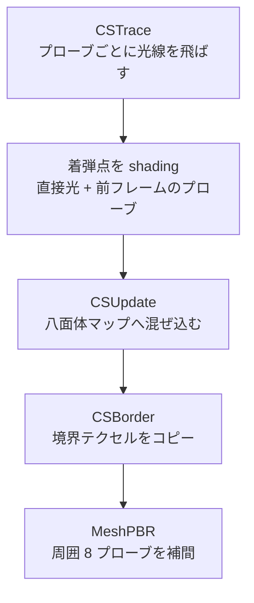

空間に置いたプローブの放射照度を毎フレーム少しずつ更新し、描画時に周囲のプローブを補間する動的 GI です (ADR 027)。光源や物体が動いても間接光が追従します。画面の外の光も拾えるので、画面空間の方式 (SSGI) は採りませんでした。

光線は、CPU で作った BVH をコンピュートシェーダで走査して飛ばします。RayQuery が使える環境では、ハードウェアのトレースに置き換わります。GI が見るのは、デモが登録した形状だけです。描画しているものと GI が見ているものがずれうる、というのは承知のうえの代償です。反射の反射は、前フレームのプローブを読んで得ます。

### 仕組み

格子状に並べたプローブは、それぞれ 2 枚の八面体マップを持ちます。放射照度 (8×8 テクセル) と、距離の 1 次・2 次モーメント (16×16 テクセル) です。全プローブ分を 1 枚のアトラスに並べ、各タイルの外側に 1 テクセルの境界を付けます。八面体マップは縁で不連続になります。境界に反対側の縁をコピーしておけば、ハードウェアのバイリニア補間がそのまま使えます。サンプラがエンジンに 1 つしかなく、クランプ指定ができないためです。

更新は 1 フレームに 3 つのコンピュートパスで進み、そのあとの描画で補間します。



`CSClear` はアトラスを 0 にするパスです。

#### 着弾点のシェーディング

光線の方向は、球面上のフィボナッチ格子を、フレームごとに回転させたものです。着弾した点の放射輝度は、次の和です。

```math
L = L_{\text{emit}} + \frac{a}{\pi}\left(E_{\text{sun}}\cos\theta\, V + \sum_k E_k + E_{\text{prev}}\, I\right)
```

`$a$` は着弾面のアルベド、`$L_{\text{emit}}$` は自発光、`$E_{\text{sun}}\cos\theta$` は太陽の寄与、`$V$` は太陽へのシャドウレイが遮られなければ 1、遮られれば 0 です。`$E_k$` は点光源 (最大 16 個) の寄与です。`$E_{\text{prev}}$` は前フレームのプローブから補間した値、`$I$` は `intensity` です。光線が何にも当たらなかったときは、環境マップか空の色を返します。

#### プローブへの混ぜ込み

八面体マップの各テクセルは、そのテクセルの方向と光線の方向の内積で重み付けした平均です。そのうえで、前フレームの値と混ぜます。

```math
w_i = \max(0,\ \mathbf{d}_{\text{texel}}\cdot\mathbf{r}_i),\quad
c = \frac{\sum_i w_i L_i}{\sum_i w_i},\quad
x' = \text{lerp}(c,\ x_{\text{prev}},\ h)
```

`$\mathbf{r}_i$` は光線 `$i$` の方向、`$h$` は `hysteresis` です。既定値は 0.96 で、1 フレームに新しい値が入る割合は 4% です。最初のフレームだけ `$h=0$` です。距離マップは重みが `$w_i=\cos^{50}$` で、`$(d,\ d^2)$` を同じ式で平均します。

光線の 4 分の 1 より多くが裏面に当たったプローブは、壁の中にあるとみなして、放射照度を 0 にします。

#### 描画時の補間

描画する点を囲む 8 個のプローブを、トリリニアの重みに「見えているか」の重みを掛けて混ぜます。見えているかは、チェビシェフの不等式で見積もります。

```math
v = \frac{\sigma^2}{\sigma^2 + (d-\mu)^2}\quad (d>\mu),\qquad
w = t_x t_y t_z \cdot v^{\max(s/16,\ 1)}
```

`$d$` はプローブから点までの距離、`$\mu$` と `$\sigma^2$` は距離マップから読んだ平均と分散です。`$d\le\mu$` のときは `$v=1$` です。`$t$` はトリリニアの重み、`$s$` は `visibilitySharpness` です。

### 実装

補間の中心部です。

```hlsl
// Shaders/DdgiCommon.hlsli
        float visibility = 1.0;
        if (distanceToProbe > moments.x)
        {
            const float variance = max(moments.y - moments.x * moments.x, 1.0e-4);
            const float difference = distanceToProbe - moments.x;
            visibility = variance / (variance + difference * difference);
            visibility = pow(saturate(visibility), max(visibilitySharpness / 16.0, 1.0));
        }

        const float3 trilinear = lerp(1.0 - alpha, alpha, float3(bit));
        const float weight = max(trilinear.x * trilinear.y * trilinear.z * visibility,
                                 1.0e-6);
```

前フレームの値との混ぜ込みは、`CSUpdate` にあります。

```hlsl
// Shaders/Ddgi.hlsl
        const float hysteresis = gPush.phase == 0u ? 0.0 :
                                                      saturate(DdgiLoadHysteresis(parameters));
        gStorageTextures[gPush.irradianceTextureIndex][atlasTexel] =
            float4(lerp(current, previous, hysteresis), 1.0);
```

既定の設定は、1 プローブあたり 128 本 (上限 256)、間隔 (1.6, 1.4, 1.6) です。

<figure>
  
  <figcaption>NightCrossing を全効果オンで描いたフレーム。--smoke 実行で時間を止め、GPU から読み戻した画像です。</figcaption>
</figure>

<figure>
  
  <figcaption>止めた同じ場面で、GI だけをオフにしたフレーム。この場面では見た目の差は小さく出ています。</figcaption>
</figure>

RayQuery でトレースする系統を含めた比較です。上がシャドウマップと BVH の GI、中が RT 影と RayQuery の DDGI、下がパストレース (SVGF) です。

<figure>
  
  <figcaption>上: シャドウマップ + BVH GI。中: RT 影 + RayQuery DDGI。下: パストレース SVGF。</figcaption>
</figure>

### 設計判断

- **SSGI を採らなかった理由。** 画面外の光を拾えず、カメラを振ると照り返しが出たり消えたりします。
- **ボクセルコーントレースを採らなかった理由。** シーンのボクセル化が別に要り、3D テクスチャへの書き込みとミップ生成も必要になります。DDGI ならアトラスは 2D テクスチャで足ります。
- **BVH を自前でコンピュートから走査する。** 当時の RHI にハードウェアレイトレーシングの機能がなかったためです。BLAS はビン分割 SAH で、TLAS と合わせて CPU で作ります。ジオメトリはデモが明示的に登録し、材質 (アルベドと自発光) は三角形が持ちます。
- **多重バウンスは前フレームのプローブで得る。** 追加のパスは要りません。そのかわり収束はフレームをまたぐので、光源が急に動くと数フレーム遅れて追いつきます。
- **RayQuery 版 (ADR 033 の H2)。** BVH 版と置き換えられます。RX 9070・1080p で光線計算は 0.25 ms から 0.15 ms に下がりました。GI の寄与は 0.0067 から 0.0297 に増えました。描画と同じ形状とマテリアルが効くためです。

### 限界

- BLAS は静的です。TLAS は毎フレーム作り直すので、インスタンス数が増えると CPU が重くなります。
- 薄い壁では光が漏れます。`visibilitySharpness` で調整します。
- 拡散のみです。間接スペキュラは環境マップのままで、鏡面の映り込みに GI は効きません。
- プローブ格子の外では、従来の環境光にフォールバックします。
- `ScrollTo` は、動いたらボリューム全体をクリアします。入ってきたプローブだけの更新ではありません。
- DDGI の照り返しはパストレーサーより弱く、GI の寄与が半分以下です (ADR 033)。材質ごとの係数で埋める案は、物理的な根拠がないので採っていません。
