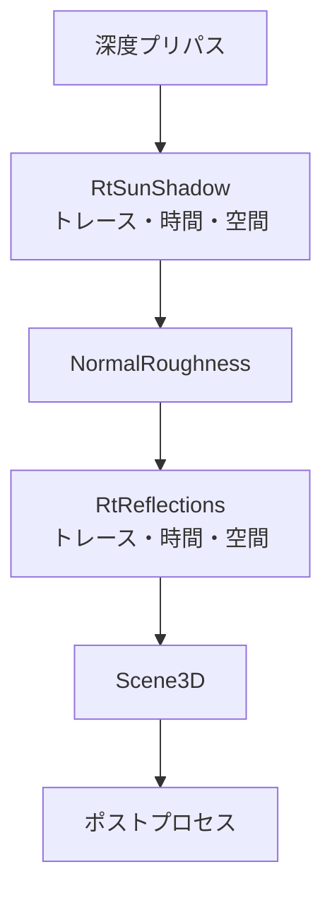

描画の主役はラスタのままで、影・GI・映り込みの 3 つにレイトレースを足します (ADR 033)。ハードウェアの RayQuery が使えるときは既定でオンになり、使えない環境では従来の手法に戻ります。

パストレーサー (1 画素ごとに光の経路を追う描画) は、1 画素 1 サンプルをノイズ除去で埋めるため、面にまだらが残ります。ラスタと見比べて「パストレしない方がきれい」という評価になったのが、この構成にした理由です。

### 仕組み

可視性・マテリアル・直接光は、従来の Forward+ (`MeshRenderer`) が担います。そのうえに、インラインの RayQuery を使う効果を 3 段階で足します。どれも個別にオンオフできます。

| 段階 | 効果 | 置き換える従来の手法 |
| --- | --- | --- |
| H1 | 太陽のレイトレース影 | カスケードシャドウマップ |
| H2 | DDGI のプローブ更新を RayQuery で行う | ソフトウェア BVH |
| H3 | 光沢面のレイトレース映り込み | 環境マップの映り込み |

H0 は、パストレーサーと共有するレイトレースシーン (BLAS / TLAS、ジオメトリとマテリアルの表) です。順番は、ノイズがほぼ出ない H1 と H2 を先にして、見た目の雰囲気を大きく変える H3 を最後にしました。



DDGI (H2) は、この前の `DdgiTrace` / `Update` / `Border` で更新されます。

#### G バッファを持たない

RHI はマルチレンダーターゲットを持たず、出力は単一です。そのため G バッファは作らず、深度プリパスの深度からワールド座標と法線を復元します。法線は隣接画素の深度差から作り、縁では差の小さい側を使います。

映り込み (H3) ではシェーディング法線と粗さが要るので、単一出力の「法線 + 粗さ」パスを足しました。

#### 太陽の影 (H1)

1 画素ごとに 1 本、太陽の方向へレイを飛ばします。太陽の視直径による半影は、レイの方向を太陽の円盤内でばらつかせて作ります。

```math
\mathbf{d} = \text{normalize}\!\left(\mathbf{s} + \sqrt{u}\,\tan\theta\,(\cos\phi\,\mathbf{t} + \sin\phi\,\mathbf{b})\right),\quad \phi = 2\pi v
```

`$\mathbf{s}$` は太陽へ向かう方向、`$\theta$` は太陽の角半径、`$u, v$` は一様乱数、`$\mathbf{t}, \mathbf{b}$` は `$\mathbf{s}$` に直交する 2 軸です。遮られたかどうかの 0/1 は、時間方向に蓄積します。履歴の長さを `$h$` (最大 16) として、新しい値の重みは次のとおりです。

```math
\alpha = \frac{1}{h+1}
```

空間フィルタの半径は、遮蔽物までの距離から半影の幅を画素に換算して決めます。

```math
r = \text{clamp}\!\left(\left\lceil \frac{\min(t_{\text{hit}},\ 4D)\,\tan\theta \cdot (H/2)\,|P_y|}{D} \right\rceil,\ 1,\ 8\right)
```

`$t_{\text{hit}}$` は遮蔽物までの距離、`$D$` はカメラからの距離、`$H$` は画面の高さ、`$P_y$` は射影行列の縦のスケールです。遮られなかった画素は距離を 0 にするので、完全に日なたの領域は最小の半径で済みます。

#### 映り込み (H3)

粗さがしきい値 (`roughnessCutoff`) 未満の画素だけが対象です。反射方向は、GGX の可視法線分布 (VNDF) から、`$\alpha = \text{roughness}^2$` でサンプルします。当たった点では、太陽・点光源の直接光と DDGI の拡散、環境マップによる近似スペキュラを足して返します。2 本目のレイは高くつくので撃ちません。トレース結果には 1.05 を掛けます。省いた多重バウンスの分の小さな補正です。

### 実装

太陽の影のレイです。最初に当たったところで探索を打ち切ります。

```hlsl
// Shaders/HybridSunShadow.hlsl
    RayQuery<RAY_FLAG_FORCE_OPAQUE | RAY_FLAG_ACCEPT_FIRST_HIT_AND_END_SEARCH> query;
    query.TraceRayInline(gAccelStructs[NonUniformResourceIndex(f.tlasIndex)],
                         RAY_FLAG_FORCE_OPAQUE | RAY_FLAG_ACCEPT_FIRST_HIT_AND_END_SEARCH,
                         kPtMaskShadowCaster, ray);
    while (query.Proceed()) {}
    const bool occluded = query.CommittedStatus() == COMMITTED_TRIANGLE_HIT;
    // A miss has no blocker and therefore no penumbra to blur. Keeping its distance at zero
    // also prevents fully lit regions from paying the maximum spatial kernel cost.
    const float hitDistance = occluded ? query.CommittedRayT() : 0.0;
```

太陽の影を 3 段で比べた画像です。上からシャドウマップ、RT、パストレースです。

<figure>
  
  <figcaption>太陽の影。上: map、中: rt、下: pt。</figcaption>
</figure>

全体の比較です。上がラスタ、中が H1 + H2 + H3 のハイブリッド、下がパストレース (SVGF) です。

<figure>
  
  <figcaption>上: ラスタ。中: H1 + H2 + H3 のハイブリッド。下: パストレース (SVGF)。</figcaption>
</figure>

### 設計判断

- **PT を磨き続けない。** spp、デノイザー、シーンの調整を重ねても、ラスタの「くっきり・ノイズなし」には届きませんでした。
- **PT を NVIDIA 限定にしない。** 技術的にはベンダーに依存していません (DXR 1.1 / `VK_KHR_ray_query`)。開発機が AMD で、CI は WARP で PT のスモークを回しているので、限定すると検証の手段を失います。
- **G バッファは入れない。** RHI の両バックエンドに手が入ります。H1 と H2 には要らず、必要になった H3 で単一出力のパスを足しました。
- **レイトレースシーンを共有する。** `PathTracer` が持っていた BLAS / TLAS と表を、共有の `pt::RtScene` に切り出し、両者から参照します。

#### 実測

RX 9070、1080p、リリース。LightingStudio で、RayQuery が使えるときは H1〜H3 が既定でオンです。

| 段階 | GPU 時間 | 判定の実測 |
| --- | --- | --- |
| H1 太陽の RT 影 | 0.54 ms | 床 51 点の CPU レイ判定との誤判定率: RT 0%、シャドウマップ 25.5% |
| H2 DDGI の RayQuery 化 | 光線計算 0.25 → 0.15 ms | GI の寄与 0.0067 → 0.0297 |
| H3 RT 映り込み | 0.88 ms (法線 + 粗さパス 0.02 ms を含む) | PT 基準との誤差: 鏡の球 0.32 → 0.24、金の球 0.075 → 0.055 |

### 限界

- DDGI の照り返しはパストレーサーの半分以下で、照り返しで明るくなった面を映す映り込みも暗くなります。金の球は PT の 0.40 倍です。材質ごとの係数で埋める案は、物理的な根拠がないので採りませんでした。
- RayQuery がない環境では、シャドウマップの光漏れ (床の誤判定 25%) が残ります。
- 頂点シェーダ方式のスキンメッシュは、法線 + 粗さパスから除外しています。
- 深度から位置を復元するパス (RT の影・映り込み) は、TAA のジッタ付きの行列で復元・再投影する必要があります。ジッタなしで復元すると、起点が元の三角形からずれて自己交差し、曲面に緯度経度状のブロック模様が出ました。
- 効果ごとに、ラスタとレイトレースの 2 系統を保守します。深度から復元した法線は、細かい形状や縁で荒くなります。
