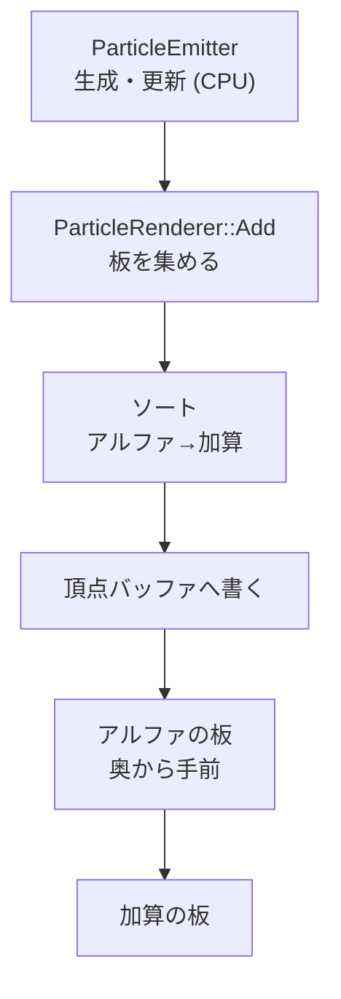

3D シーンに炎や煙を載せるためのパーティクルです。シミュレーションは CPU で、乱数は固定の式と消費順にしてあります。同じシードなら、粒子の並びが完全に一致します。

描画は、カメラに向いた板 (ビルボード) を CPU で作って、動的バッファに書く方式です。透過の扱いは、アルファの粒子を奥から手前に並べ替えて先に描き、加算の粒子を並べ替えずに後で描きます (ADR 011)。数万個を超える規模になったら、GPU 側へ移す案を残してあります。

### 仕組み

`ParticleEmitter` が粒子を生成・更新し、`ParticleRenderer` がそれを板にして描きます。



#### 更新

粒子の更新は、加速度、減衰、移動の順です。

```math
\mathbf{v} \leftarrow (\mathbf{v} + \mathbf{a}\,\Delta t)\cdot\max(0,\ 1 - k\,\Delta t),\qquad
\mathbf{x} \leftarrow \mathbf{x} + \mathbf{v}\,\Delta t
```

`$\mathbf{a}$` は加速度、`$k$` は `drag` です。大きさと色は、粒子の年齢に応じたカーブ (Size / Color over life) で決まります。

#### 決定論

乱数は線形合同法 (LCG) で、乗数と加数は固定です。粒子を 1 つ出すたびに、乱数の消費順も固定です。位置の揺らぎ 3 つ、速度の揺らぎ 3 つ、寿命の順で 7 回引きます。シードが同じなら粒子の並びが一致することは、テストで確かめています。

#### 描画とブレンド

RHI に、ブレンドモード `kOpaque` / `kAlpha` / `kAdditive` を持たせました。加算は `ONE / ONE` です。加算のエミッタは、アルファが寄与しないので、色のカーブで RGB を 0 に落としてフェードさせます。HDR のシーンでは色が 1.0 を超えてよく、ブルームが炎の発光を拾います。

描くのは、シーンパス (Scene3D) の末尾、不透明ジオメトリのあとです。深度テストは有効 (Reversed-Z で `kGreaterEqual`)、深度書き込みは無効、カリングは無効です。専用のレンダーグラフパスは作りません。深度アタッチメントが既にバインドされていて、バリアを足さずに済むためです。

### 実装

並べ替えの比較関数です。アルファの板を先に、視線方向の深度が大きい (遠い) ものから並べます。加算の板はあとに回し、順序を問いません。

```cpp
// Engine/Renderer/Src/ParticleRenderer.cpp
        std::sort(m_quads.begin(), m_quads.end(),
                  [](const Quad& lhs, const Quad& rhs)
                  {
                      const bool lhsAdditive = lhs.blend == rhi::BlendMode::kAdditive;
                      const bool rhsAdditive = rhs.blend == rhi::BlendMode::kAdditive;
                      if (lhsAdditive != rhsAdditive)
                      {
                          return !lhsAdditive;
                      }
                      if (!lhsAdditive && lhs.viewDepth != rhs.viewDepth)
                      {
                          return lhs.viewDepth > rhs.viewDepth;
                      }
                      return lhs.texture.Index() < rhs.texture.Index();
                  });
```

更新の本体は次のとおりです。

```cpp
// Engine/Renderer/Src/ParticleSystem.cpp
        const f32 dragFactor = Max(0.0f, 1.0f - m_desc.drag * dt);
        for (Particle& particle : m_particles)
        {
            particle.velocity += m_desc.acceleration * dt;
            particle.velocity *= dragFactor;
            particle.position += particle.velocity * dt;
```

ジオラマのシーンの記録画像です。

<figure>
  
  <figcaption>焚き火 (加算合成)。ADR 011 の記録画像です。</figcaption>
</figure>

<figure>
  
  <figcaption>煙 (アルファ合成) と発光。ADR 011 の記録画像です。</figcaption>
</figure>

### 設計判断

- **シミュレーションは CPU、単一の `ParticleEmitter` を Vec3 にする。** 2D 用の別クラスやテンプレート化は採りませんでした。複製するロジックが約 200 行あるのに対し、Vec3 化と XY 投影で両用途を 1 つのクラスで賄えます。2D 用途は `AppendSprites()` が xy を投影して使います。
- **インスタンシングにしない。** RHI に頂点属性のインスタンス単位の読み出しがありません。ストレージバッファ方式は、頂点生成がシェーダ側に移って、ユニットテストが難しくなります。目標の規模 (8192 クアッド以下) では、CPU での展開で足ります。
- **SpriteBatch の拡張にしない。** 2D のままでは、3D シーンの深度と整合しません。
- **独立したレンダーグラフパスにしない。** GPU 時間を分離できる利点はありますが、ロードオペレーションとバリアの追加が要り、リスクが高いと判断しました。
- **PSO キャッシュに `blendMode` を含める。** アルファ用と加算用は、ブレンドモードだけが違う 2 本のパイプラインです。ハッシュと比較の両方に含めないと、2 本目が 1 本目に誤って重複扱いされます。回帰テストがあります。

### 限界

- 板の数には上限があります。超えた分は描かず、捨てた数を数えます。ADR の想定規模は 8192 クアッド以下です。
- 数万個を超える規模では、GPU シミュレーションや、ストレージバッファによるインスタンシングが将来案として残っています。実装はありません。
- ソフトパーティクル (深度でふちを柔らかくする処理) も将来案で、未実装です。
- アルファ粒子の並べ替えは板ごとの視点深度です。加算の粒子は並べ替えません。
