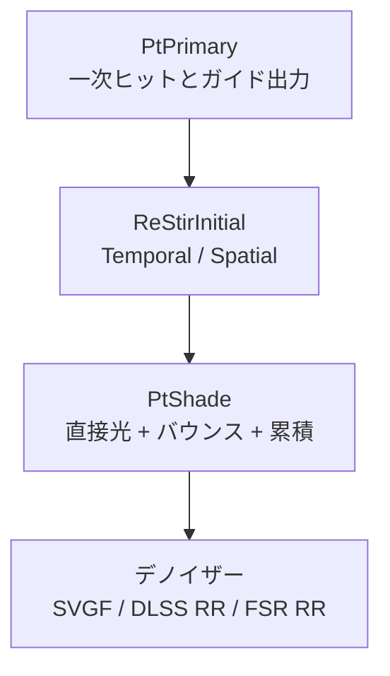

基準画像を作るためのパストレーサーです。光の経路を 1 画素ずつ追う方式で、ほかの描画手法の見た目を比べる「正解」に使います。ハードウェア RT はインラインの RayQuery だけにして、専用のパイプラインやシェーダーバインディングテーブルは持ちません (ADR 031)。ノイズ除去は自作の SVGF に加えて、DLSS Ray Reconstruction と FSR Ray Regeneration を使えます。

現在は β 機能として凍結していて、既定の描画はハイブリッドです (ADR 033)。DLSS Ray Reconstruction は RTX の実機で一度も動かしていません。FSR Ray Regeneration は、この場面では SVGF より壁のまだらが約 2 倍でした。

### 仕組み

すべてコンピュートシェーダで、RayQuery は既存のバインドレス資源にそのまま載ります。パス構成は次のとおりです。



間接光用の ReSTIR GI (`GiInitial` / `GiTemporal` / `GiSpatial`) も、同じ形のパスです。図は直接光の流れ (ADR 031 4.1) を示しています。

実装は段階を踏んで足してあり、先の段階を比較基準として残しています。順に、基準パストレーサー (Next Event Estimation + Multiple Importance Sampling)、Reservoir Importance Sampling (RIS)、ReSTIR DI、ReSTIR GI です。

- 一次ヒットの直接光は、1 サンプルの NEE (基準)、RIS、ReSTIR DI から選べます。既定は ReSTIR の時空間再利用です。
- 間接光は、一次ヒットから BSDF で見つけた二次頂点を ReSTIR GI で再利用します。バウンス数の既定は 4 です。
- 光源は点光源とエミッシブ三角形を 1 本のリストにして、パワーに比例するエイリアステーブルで選びます。太陽はリストに入れず、各頂点で通常の NEE をします。
- エミッシブは BSDF レイが一次ヒットで当たったときだけ数えます。それ以外の頂点は、光源リストの NEE で拾うので、二重に数えません。

#### 自作 SVGF

ノイズ除去は `IDenoiser` の境界で差し替えます。入力は DLSS Ray Reconstruction と同じ集合 (ノイズ付きの色、拡散・鏡面アルベド、法線 + ラフネス、深度、モーションベクトル、鏡面ヒット距離) にそろえ、特定のデノイザーに契約を固定しないようにしています。

`SvgfDenoiser` は、拡散と鏡面を分けて、時間方向の蓄積、分散推定、5×5 の à-trous フィルタの順に処理します。履歴は ReLAX 方式で、フィルタ前の時間方向の結果を残します。

履歴への混ぜ込みの重みは、履歴の長さ `$n$` (拡散は最大 `maxHistory`=32、鏡面はラフネスで 4〜32) から決まります。

```math
\alpha = \max\!\left(\frac{1}{n},\ \alpha_{\min}\right),\qquad \alpha_{\min}=0.05
```

à-trous フィルタの各タップの重みは、カーネル・幾何・輝度の 3 つの積です。反復 `$i$` のタップ間隔は `$2^i$` 画素で、反復回数の既定は 3 です。

```math
w = k(x)\,k(y)\cdot \exp\!\left(-\frac{|z_c-z_s|}{\sigma_z\, z_c\, 2^i}\right)\cdot \max(0,\ \mathbf{n}_c\!\cdot\!\mathbf{n}_s)^{p}\cdot \exp\!\left(-\frac{|L_c-L_s|}{\sigma_L\sqrt{\text{Var}}}\right)
```

`$k$` は B3 スプラインの重み (0, ±1, ±2 で 3/8, 1/4, 1/16)、`$z$` は視点からの深度、`$\mathbf{n}$` は法線、`$L$` は輝度、`$\text{Var}$` は分散です。添字 `$c$` は中心、`$s$` はタップを表します。既定値は `$\sigma_z=1$`、`$p=128$`、`$\sigma_L=4$` です。鏡面の重みにはさらに、ラフネスの差による `$\exp(-|\Delta\text{roughness}|/0.1)$` が掛かります。

### 実装

à-trous の 1 タップ分の重みの計算です。

```hlsl
// Shaders/DenoiseAtrous.hlsl
            const float kernelWeight = DnB3Kernel(x) * DnB3Kernel(y);
            const float geometryWeight = DnEdgeWeight(
                centerGuide.z, guide.z, centerNormal, DnOctDecode(guide.xy),
                gPush.stepSize, gPush);
            const float diffuseWeight = kernelWeight * geometryWeight * DnLuminanceWeight(
                centerLuminance.x, DnLuminance(diffuse.rgb),
                filteredVariance.x, gPush.luminanceSigma);
```

最終の反復は、放射輝度のフィルタと同時に、色の合成まで行います。

```hlsl
// Shaders/DenoiseAtrous.hlsl
    const float3 outputColor = emission + diffuseAlbedo * diffuse +
                               specularAlbedo * specular;
```

3 つのノイズ除去の比較と、輪郭の拡大です。

<figure>
  
  <figcaption>左から raster / pt_svgf / pt_fsr の拡大。</figcaption>
</figure>

<figure>
  
  <figcaption>左から Reference / SVGF before (no AA) / SVGF + TAA (now)。輪郭の拡大です。</figcaption>
</figure>

### 設計判断

- **インライン RayQuery のみ。** 既存のコンピュートとバインドレスの資源モデルにそのまま載り、レイ生成後の ReSTIR とノイズ除去までコンピュート内で完結します。専用パイプラインと SBT を併設して、2 つの実行・バインドモデルを保守する利点はありませんでした。
- **ソフトウェア BVH 経路は後回し。** WARP が DXR 1.1 の RayQuery をそのまま実行できるため、GPU のない CI でもハードウェア経路そのものを検証できます。`PathTracer::Initialize` は RayQuery 非対応のデバイスで `kUnsupported` を返し、アプリはラスタ描画のまま続けます。
- **履歴はフィルタ前の結果にする。** SVGF の「à-trous 1 回目の出力を履歴へ戻す」方式では、ぼかした画像を毎フレーム履歴へ戻すため陰影の勾配が次第になまり、静止 16 → 64 フレームで誤差が増えました (0.24 → 0.27)。フィルタ前の結果を履歴にすると 0.21 → 0.19 と下がりました。
- **PT は NVIDIA 限定にしない。** ADR 033 によると、既定の描画はどの環境でもハイブリッドかラスタで、PT はオプトインです。RayQuery 対応の GPU と WARP では、SVGF で動きます。

### 限界

- β 機能として凍結しています。レンダリングの開発はハイブリッドで一区切りにしました。
- DLSS Ray Reconstruction は、RTX の実機で一度も動かしていません。
- FSR Ray Regeneration は spp を上げても良くならず、この場面では SVGF より壁のまだらが約 2 倍です。AMD Radeon RX 9000 シリーズの DX12 のみ対応です。
- スキンメッシュは、トレースされません。
- RayQuery 非対応のデバイスでは使えません。
- 自作デノイザーは、ADR 031 の記録で 5.2 ms (RX 9070、1080p) です。一般的な SVGF (1〜2 ms) より重く、最適化の余地があります。à-trous の共有メモリ化や、半解像度の分散推定が案として挙がっています。
