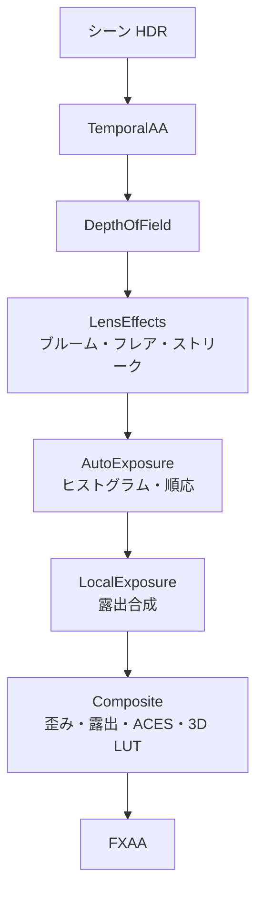

シーンの HDR 画像を、画面に出す色へ変える一連の処理です。アンチエイリアス、被写界深度、レンズ効果、露出、トーンマップ、カラーグレーディングを、固定の順序で並べたスタックにまとめています (ADR 026)。各段は個別にオフにできます。

ADR の時点では、ポストエフェクトが Sandbox の `main` に直接書かれていて、デモを増やすたびにコピーしていました。複数のデモ (LightingStudio と水面デモ) で使うため、エンジン側の部品にしました。

### 仕組み

順序は固定です。



使う側の呼び出しは `SetSettings` → `Prepare` → `AddPasses` の 3 つです。各段のクラスは公開されていて、デモのスモークテストから中間結果やカウンタを見られます。

順序の理由は、ADR に書かれています。

- 被写界深度は最初です。ぼけたあとの画像からフレアやブルームを作るほうが、実レンズに近いためです。
- ブルームとフレアは、露出を掛ける前の HDR から作ります。前フレームの露出値を掛けてからしきい値を取るので、同じフレームの順応を待たず、露出の計測と依存し合いません。
- 合成は 1 パスです。歪み・露出・トーンマップ・LUT を 1 回のフルスクリーン描画にまとめます。

#### 自動露出

1/4 解像度相当のヒストグラム (64 ビン、log2 空間) をコンピュートシェーダで作ります。ビンの上下の外れを除いた平均の EV を目標にして、明るくなる方向と暗くなる方向で速さの違う指数追従をします。結果は GPU 上のバッファに置き、CPU を往復しません。

```math
\text{EV}_{100} = \log_2(8\,L),\qquad
\text{EV}' = \text{EV} + (\text{EV}_{\text{target}}-\text{EV})\left(1-e^{-k\,\Delta t}\right),\qquad
E = \frac{1}{1.2\cdot 2^{\text{EV}}}
```

`$L$` は輝度、`$k$` は速さです。目標が現在より明るければ `speedUp` (既定 3.0)、暗ければ `speedDown` (既定 1.2) を使います。`$E$` が色に掛ける露出です。ヒストグラムの平均は、既定では下位 50%〜上位 95% の範囲の重み付き平均です。

#### 露出合成

Mertens の露出合成を、輝度だけ・1/4 解像度で行います。基準・暗め・明るめの 3 露出について、適正露出度の重みをガウスピラミッドでぼかして合成し、ゲインマップ (log2) を作ります。合成段では、輝度をガイドにしたバイラテラル補間で拡大します。適正露出度は、表示値 `$v$` が 0.5 に近いほど大きくなります。

```math
w(v) = \exp\!\left(-\frac{(v-0.5)^2}{2\cdot 0.2^2}\right)
```

#### 合成とトーンマップ

合成のパスでは、露出を掛け、ゲインマップ、ブルーム、フレアを足し、ACES で圧縮して、最後に 32³ の 3D LUT を引きます。

```math
f(x) = \text{saturate}\!\left(\frac{x\,(2.51\,x + 0.03)}{x\,(2.43\,x + 0.59) + 0.14}\right)
```

これは ACES を近似した有理関数です。入力が無限大だと分子と分母がともに無限大になり、NaN になります。そこで、曲線に入れる前に、シーン + ブルーム + フレアの値を有限の範囲 (0〜65504) に丸めます。

### 実装

```hlsl
// Shaders/PostComposite.hlsl
    float3 color = SampleScene(uv) * exposure;

    if (gPush.gainMapIndex != kInvalidIndex && gPush.gainMapWidth > 0u && gPush.gainMapHeight > 0u)
    {
        const float logLuminance = log2(max(Luminance(color), 1.0e-5));
        color *= exp2(BilateralGain(uv, logLuminance));
    }
    // ...
    color = AcesFilm(SanitizeHdr(color));
```

適正露出度の重みと順応の式は、`PostProcessMath.h` に C++ の参照実装があり、ユニットテストが付いています。シェーダは同じ式を書き、式を変えるときは両方を直す方針です (ADR 026)。

全効果をオンにした画面と、GI・ボリューム・ランタン・光線だけ残してポストエフェクトを切った画面です。

<figure>
  
  <figcaption>全効果オン。--smoke 実行の同じフレーム番号を GPU から読み戻しています。</figcaption>
</figure>

<figure>
  
  <figcaption>GI・ボリューム・ランタン・光線だけを残し、ポストエフェクトを切ったもの。</figcaption>
</figure>

### 設計判断

- **各段のシェーダの読み込みはスタック自身が行う。** スタックは 10 本以上のシェーダを持つので、呼ぶ側に並べさせず `FileSystem` を受け取って自分で読みます。
- **シェーダは機能ごとの CMake 断片で登録する。** `Shaders/cmake/*.cmake` を `Shaders/CMakeLists.txt` が glob して include します。並列作業で共有ファイルの編集が衝突するのを避けるためです。
- **被写界深度は薄レンズの錯乱円 (CoC)。** 半解像度で、近景をダイレーションし、96 サンプルの黄金角ギャザー (遠景と近景を分離) で処理して、フル解像度で合成します。ボケ形状は円または多角形で、アナモルフィックでは縦長の楕円にします。
- **カラーグレーディングは CPU で 3D LUT に焼く。** 32³、RGBA16F で、設定が変わったときだけ焼き直します。ホワイトバランス (Bradford)、Lift/Gamma/Gain、log 空間のコントラスト、彩度、スプリットトーンの順です。

### 限界

- ブルームとフレアの露出は 1 フレーム遅れます。急な明暗の変化では、1 フレームだけ強さがずれます。
- LUT は表示空間 (トーンマップ後) の [0,1] に適用します。HDR のままのグレーディング (ACEScc など) ではありません。
- 出力は sRGB エンコードをしません。UNORM 出力の扱いは、既存の `Tonemap.hlsl` に合わせています。
- Sandbox は、スタックに移行していません。`Sandbox/Main.cpp` は `PostProcessStack` を使わず、独自のトーンマップのパスを持っています。ADR 026 も、TAA / ブルーム / GTAO は Sandbox のインライン実装のままとしています。
