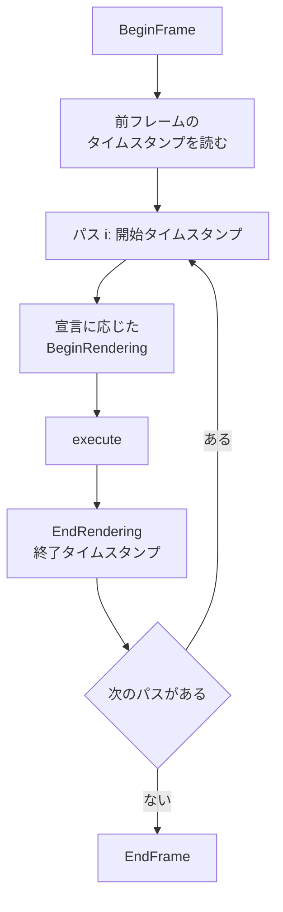

フレームの描画を「パスの並び」として宣言し、バックバッファの取得から提出までをまとめて面倒見る仕組みです。パスごとの GPU 時間も、ここでタイムスタンプクエリを差し込んで取ります。

ただし今の実行順は、宣言した順そのままです。依存関係から順序を決める処理、一時リソース、メモリの再利用は、ヘッダのコメントで今後の作業とされていて、まだありません。

### 仕組み

パスは `AddPass(名前, setup, execute)` で登録します。`setup` はその場で呼ばれ、パスが何に描くかを `PassBuilder` に宣言します。`execute` は `Execute()` の中で、順番に呼ばれます。

宣言できる出力先は次の 3 種類です。

- バックバッファ (`WriteBackbuffer`)。必要なら `WriteDepth` で深度を付けます。
- オフスクリーンのカラー (`WriteColorTarget`)。HDR のシーンターゲットなどに使います。
- 深度だけ (`WriteDepthOnly`)。シャドウマップ用です。

どれも宣言しないパスは、描画スコープの外で `execute` を呼びます。アップロードやコンピュートのためです。



バックバッファの開始と終了、ロードの扱いはグラフだけが決めます。ヘッダには、`BeginRenderingToSwapchain` を呼んでよいのはグラフだけで、手書きのバリアはグラフの外では禁止、と書いてあります。ロードオペレーションは宣言どおりに使われます。通常は最初のバックバッファパスがクリアし、以降のパスはロードします。

最小の使い方は、ヘッダのコメントにあります。

```cpp
// Engine/Renderer/Include/Nexus/Renderer/RenderGraph.h
//   graph.Reset();
//   graph.AddPass(
//       "Scene",
//       [&](nx::RenderGraph::PassBuilder& b)
//       { b.WriteBackbuffer(nx::rhi::LoadOp::kClear, clearColor); },
//       [&](nx::RenderGraph::PassContext& ctx)
//       { ctx.cmd.SetPipeline(...); ctx.cmd.Draw(...); });
//   graph.Execute(*swapchain);
```

### GPU 時間の計測

パス `i` はタイムスタンプのスロット `2i` と `2i+1` を使います。`Execute` はパスの前後で `WriteTimestamp` を呼びます。結果は次のフレームの `BeginFrame` のあとに読み戻すので、表示は数フレーム遅れます。

```cpp
// Engine/Renderer/Src/RenderGraph.cpp
            const u64 begin = ticks[2 * i];
            const u64 end   = ticks[2 * i + 1];
            // Unwritten/unavailable slots read back as 0; skip those (report 0 ms).
            const f64 ms = (end > begin) ? (static_cast<f64>(end - begin) * periodNs) / 1.0e6 : 0.0;
```

`periodNs` は 1 チックのナノ秒です。ミリ秒にするため `1.0e6` で割ります。バックエンドのクエリスロットが全パスの分に足りないときは、計測自体を行いません。タイムスタンプに対応しないバックエンドでは、結果は空です。

Sandbox では、この結果が右の Performance パネルの GPU 欄に出ます。

<figure>
  
  <figcaption>Sandbox の Performance パネル。ClusterAssign、ShadowMap、DepthPrePass、Velocity、Gtao、Scene3D、SceneColorCopy、Scene3DTransparent、PostTemporalAA、BloomExtract、BloomBlurH、BloomBlurV、Tonemap、SpritesAndUI のパスごとの時間が出ています。GPU 合計は 0.90 ms です。</figcaption>
</figure>

### 設計判断

ヘッダ自身が「スケルトン」と名乗っていて、宣言順の実行に絞っています。バックバッファの開始・終了とバリアをグラフの中に閉じ込める点が、今の役割です。依存関係から決める順序、一時リソース、メモリのエイリアシングは、ヘッダのコメントで「M2 resource slice」で入れるものとされています。

### 限界

- 実行は宣言順です。パスの並べ替えや、不要なパスの除去はしません。
- 一時リソースの管理とメモリの再利用 (エイリアシング) はありません。ターゲットは呼び出し側が作ります。
- GPU 時間は、バックエンドがタイムスタンプに対応していて、クエリスロットがパス数の 2 倍以上あるときだけ取れます。
