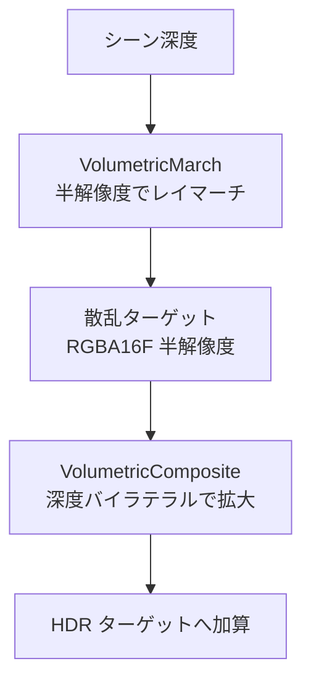

スポットライト専用のレイマーチで、光源から伸びる筋だけを出します (ADR 028)。雨や霧の中で、灯台のビームや街灯が光の柱に見える絵のためです。

霧のボリュームを全方位に持たないのは、欲しい絵が空間全体の霧ではないからです。スポットに限れば、コーンの外で早く計算を打ち切れます。半解像度でレイマーチし (ステップ数の既定は 48、NightCrossing は 80)、深度を見ながら元の解像度へ戻します。

散乱係数は、光を何メートル先まで届かせたいかから逆算します。最初に雨天らしく `1.8 /m` にしたところ、数 m で光が尽きて、光条がまったく出ませんでした。

### 仕組み

`VolumetricLighting` が、2 つのパスをレンダーグラフに積みます。



`VolumetricMarch` は、カメラからシーン深度までを `N` 歩で進みます。1 歩ごとに、各スポット (最大 4 灯) の寄与を足します。

```math
S \mathrel{+}= T \cdot I \cdot \sigma\,\Delta s,\qquad T \mathrel{*}= e^{-\sigma\,\Delta s}
```

`$S$` が積算した散乱光、`$T$` が透過率 (初期値 1)、`$\sigma$` が散乱係数、`$\Delta s$` が 1 歩の長さです。`$I$` は、その歩の位置でスポットから届く光です。

```math
I = c \cdot \text{cone}\cdot \frac{(1-(d/R)^2)^2}{\max(d^2,\ 0.25)} \cdot \text{HG}(\cos\theta,\ g)
```

`$c$` は光の色と強さ、`$d$` は光源からの距離、`$R$` は `range` です。`$d \ge R$` では 0 です。`$\text{cone}$` は、内側のコーンの余弦と外側の余弦のあいだを smoothstep でつないだ値です。距離の 2 乗の下限 0.25 は、光源のすぐそばで値が発散しないためのものです (後述)。

位相関数は Henyey-Greenstein です。`$g$` は異方性で、正だと前方に強く散乱します。

```math
\text{HG}(\cos\theta,\ g) = \frac{1-g^2}{4\pi\,(1+g^2-2g\cos\theta)^{3/2}}
```

歩の位置は、4×4 の Bayer パターンでずらします。縞が細かいノイズになり、アップサンプルで均されます。パターンは毎フレーム同じなので、カメラが止まっていれば画像も止まります。時間方向のフィルタは使いません。

`VolumetricComposite` は、半解像度の 2×2 の近傍を、深度の差で重み付けして混ぜます。

```math
w = \max(1-|\Delta x|,\ 0)\max(1-|\Delta y|,\ 0)\cdot\frac{1}{1+64\,|z_s-z_c|/z_c}
```

`$z_c$` は中心の画素の深度、`$z_s$` は近傍の深度です。

### 実装

マーチの内側です。

```hlsl
// Shaders/Volumetric.hlsl
            const float coneCosine = dot(coneDirection, directionOuter.xyz);
            const float coneT = saturate((coneCosine - directionOuter.w) /
                                         max(colorInner.w - directionOuter.w, 1.0e-6));
            const float cone = coneT * coneT * (3.0 - 2.0 * coneT);
            const float attenuation = DistanceAttenuation(distanceToLight, positionRange.w);
            const float phase = HenyeyGreenstein(dot(directionOuter.xyz, -rayDirection),
                                                 medium.y);
            incident += colorInner.rgb * (cone * attenuation * phase);
```

```hlsl
// Shaders/Volumetric.hlsl
        scattering += transmittance * incident * (medium.x * stepLength);
        transmittance *= exp(-medium.x * stepLength);
```

NightCrossing は、`scattering=0.055`、`anisotropy=0.62`、`stepCount=80`、`maxDistance=140` m を設定しています。`0.055 /m` は、灯台まで届かせたい 60 m 先で `$e^{-0.055\times 60}\approx 0.037$` になる値です。

全効果をオンにした画面と、ボリュームライトだけ切った画面を比べます。動画は NightCrossing の実録です。

<figure>
  
  <figcaption>全効果オン。--smoke 実行の同じフレーム番号を GPU から読み戻しています。</figcaption>
</figure>

<figure>
  
  <figcaption>ボリュームライトだけをオフにしたもの。</figcaption>
</figure>

<figure>
  <video src="/images/works/nexus-nightcrossing.mp4#t=0.1" controls loop muted playsinline preload="metadata"></video>
  <figcaption>NightCrossing の実録。</figcaption>
</figure>

### 設計判断

- **全方位の媒質にしなかった。** 欲しいのは「光源から伸びる筋」で、シーン全体の霧ではありません。スポットに限れば、コーンの外を早期に打ち切れます。ADR には、半解像度で `VolumetricMarch` が 0.08 ms という実測が書かれています。
- **半解像度にした。** 散乱は空間的に滑らかなので、深度を見たバイラテラルアップサンプルで輪郭を崩さずに戻せます。フル解像度だと 4 倍のコストがかかります。
- **散乱係数は「届く距離」から決める。** 透過率が `$e^{-\sigma d}$` なので、値を上げても濃くなるのではなく、近くで止まります。
- **距離の 2 乗に下限を置く。** 歩が光源の数 cm を通ると、光が 1e4 倍になります。RGBA16F は 65504 で飽和するため、無限大になり、ブルームの連鎖が黒い矩形に広げました。散乱の出力は 1024 に丸め、有限でない値は 0 にします。

### 限界

- 光の筋は、ジオメトリに遮られません (影なし)。スポットライトが自前の深度マップをまだ持たないためです。
- 太陽 (平行光源) の筋は出せません。必要になった時点で、パスを足す想定です。
- スポットは最大 4 灯です (`kMaxVolumetricSpots`)。
- ステップ数は線形にコストが増えます。既定値は 48 で、NightCrossing は 80 に設定しています。
