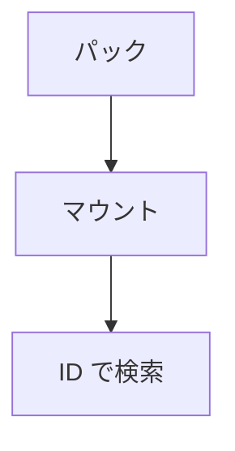

クックした `.nxpak` をマウントして、アセット ID から中身を引く層です。パックのバイト列を所有し、圧縮していないエントリはコピーせずにそのまま見せます（ADR 017）。

元のファイルのパスからも引けます。マテリアルがテクスチャをソースのパスで持つので、クックのマニフェストから「パス → ID」の索引を作ります。マウントは複数回でき、同じ ID は後からマウントしたほうが勝つので、差分のパックでベースを置き換えられます。

### 仕組み

マニフェストがない場合は ID による読み出しだけが使えます。パスの逆引きにはマニフェストが必要で、ビューはアンマウントまで有効です。



### 実装

```cpp
// Engine/Resource/Include/Nexus/Resource/AssetDatabase.h
        // packPath / manifestPath are read through FileSystem. manifestPath may be nullptr; in
        // that mode only AssetId-based reads are available.
        Result<void, MountError> Mount(FileSystem& fs,
                                       const char* packPath,
                                       const char* manifestPath);

        void Unmount();
        bool IsMounted() const;
        u32 MountedPackCount() const;

        bool ResolvePath(StringView sourcePath, AssetId& outId) const;
        // Reverse of ResolvePath, for tools that enumerate assets and need a name to show.
        // Only available for packs mounted with a manifest. The view points into the
        // database and stays valid until Unmount().
        bool TryGetSourcePath(AssetId id, StringView& outSourcePath) const;
        bool TryGetTypeTag(AssetId id, u64& outTypeTag) const;

        Result<PackBlob, AssetError> Read(AssetId id, Array<u8>& outStorage) const;
```
