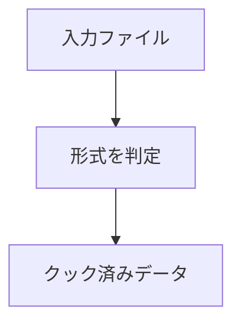

画像（PNG / JPEG）はミップマップと BC1 / BC3 / BC5 の圧縮を選べるテクスチャにします（ADR 016）。メッシュ（glTF / glb / FBX）、マテリアル、フォントもクックします。知らない形式のファイルは、黙って捨てずにそのまま格納します。

実行ファイルは `NexusCook` です。入力フォルダを `.nxpak` にまとめ、指定すればマニフェストも書き出します。マニフェストの並びを ID の昇順に固定しているのは、書き出す順序が実行ごとに変わらないようにするためです（ADR 017）。

### 仕組み

テクスチャは RGBA8 と BC1 / BC3 / BC5 を選べます。ミップ生成は既定では無効で、設定で有効にできます。.nxmeta は設定用のサイドカーです。



### 実装

```cpp
// Engine/Resource/Include/Nexus/Resource/AssetCooker.h
    enum class CookAssetType
    {
        kUnsupported, // Not an asset at all: .nxmeta sidecars.
        kTexture,     // .png / .jpg / .jpeg
        kMesh,        // .gltf / .glb / .fbx
        kMaterial,    // .nxmat (see CookedAssets.h)
        kFont,        // .ttf / .otf (see CookedAssets.h)
        kBinary,      // Anything else: stored byte for byte, so nothing is dropped silently.
    };
```
