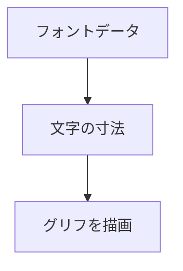

TrueType のフォントを読み込んで、グリフごとに寸法と文字の形をラスタライズします。クッカーを通すと `.ttf` / `.otf` のフォントとして格納されます。エディタの新しい UI では、使われた文字だけを動的にアトラスへ載せます（ADR 037）。

### 仕組み

フォントのバイト列は呼び出し側が所有し、FontFace の使用中は保持する必要があります。グリフの有無、寸法、ラスタライズを別々に問い合わせられます。



### 実装

```cpp
// Engine/Resource/Include/Nexus/Resource/Font.h
    // The caller owns the font bytes and must keep them alive for this face.
    struct FontFace
    {
        const void* data = nullptr;
        usize size = 0;
        u32 faceIndex = 0;

        bool HasGlyph(u32 codepoint) const;
        Result<FontGlyphMetrics, FontError> GetGlyphMetrics(u32 codepoint, f32 pixelHeight,
                                                           IAllocator& allocator) const;
        Result<void, FontError> RasterizeGlyph(u32 codepoint, f32 pixelHeight, u8* dest,
                                               usize destStride, IAllocator& allocator) const;
        Result<FontVerticalMetrics, FontError> GetVerticalMetrics(f32 pixelHeight) const;
    };

    Result<FontFace, FontError> LoadFontFace(const void* data, usize size, u32 faceIndex);
```
