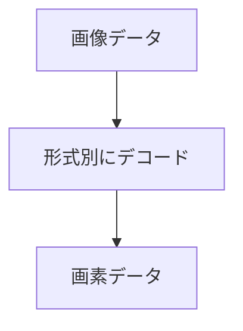

PNG、JPEG、EXR を読みます。JPEG はベースラインのみで、プログレッシブ形式には対応していません（ADR 010）。EXR は、PIZ と DWAA / DWAB の圧縮を展開できます。クッカーの対象は PNG と JPEG で、EXR は入っていません。

### 仕組み

JPEG の出力はアルファ 255 の RGBA8 です。EXR は単一パートのスキャンライン画像を対象とし、タイル、deep、複数パートは対象外です。出力は 32 ビット浮動小数の RGBA です。



### 実装

```cpp
// Engine/Resource/Include/Nexus/Resource/Image.h
    // Baseline sequential DCT JPEG (JFIF/Exif): 8-bit huffman, grayscale or YCbCr,
    // 4:4:4 / 4:2:2 / 4:2:0 chroma subsampling, restart markers. Progressive,
    // arithmetic-coded, and 12-bit files are rejected with kUnsupportedFormat.
    // Output is RGBA8 (alpha = 255), same contract as DecodePng.
    Result<Image, ImageError> DecodeJpeg(const void* data, usize size, IAllocator& allocator);

    // OpenEXR subset: single-part scanline images, increasing line order,
    // NONE/ZIPS/ZIP/PIZ/DWAA/DWAB compression, half or float R/G/B or Y-only grayscale
    // (A optional, defaults to 1). Covers the HDRI environment maps and Poly Haven
    // texture EXRs (roughness/metallic/normal); tiled/deep/multi-part files are rejected.
    Result<ImageF, ImageError> DecodeExr(const void* data, usize size, IAllocator& allocator);
    void FreeImage(ImageF& image);
```
