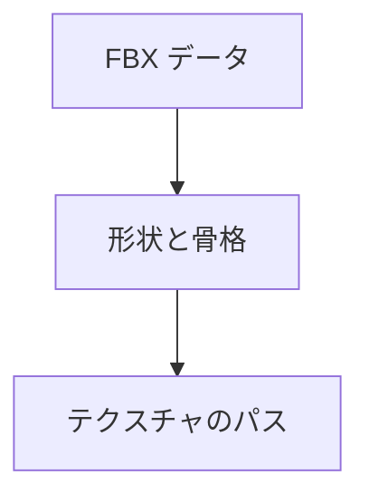

glTF（glb と、埋め込み形式の gltf）とバイナリ FBX を読みます。FBX は、スケルトン・スキン・アニメーションも対象です（ADR 022）。ASCII 形式の FBX は対象外です（ADR 010）。FBX の外部テクスチャは、パスだけを返します。

### 仕組み

FBX は左手系の Y-up、メートル単位へ変換し、ポリゴンを三角形に分割します。外部テクスチャの読み込みと接続は呼び出し側の仕事です。



### 実装

```cpp
// Engine/Resource/Include/Nexus/Resource/Fbx.h
    // Loads a binary FBX into engine conventions: left-handed Y-up, meters
    // (UnitScaleFactor applied), triangulated (polygon fan), row-vector transforms
    // baked into the vertices per Model node. Missing normals/tangents are generated
    // the same way as in the glTF importer.
    Result<FbxData, FbxError> LoadFbx(const void* data, usize size,
                                      IAllocator& allocator = GetSystemAllocator());

    Result<FbxSkinnedData, FbxError> LoadFbxSkinned(
        const void* data, usize size, IAllocator& allocator = GetSystemAllocator());

    Result<AnimationClip, FbxError> LoadFbxAnimation(
        const void* data, usize size, const Skeleton& skeleton,
        IAllocator& allocator = GetSystemAllocator());
```
