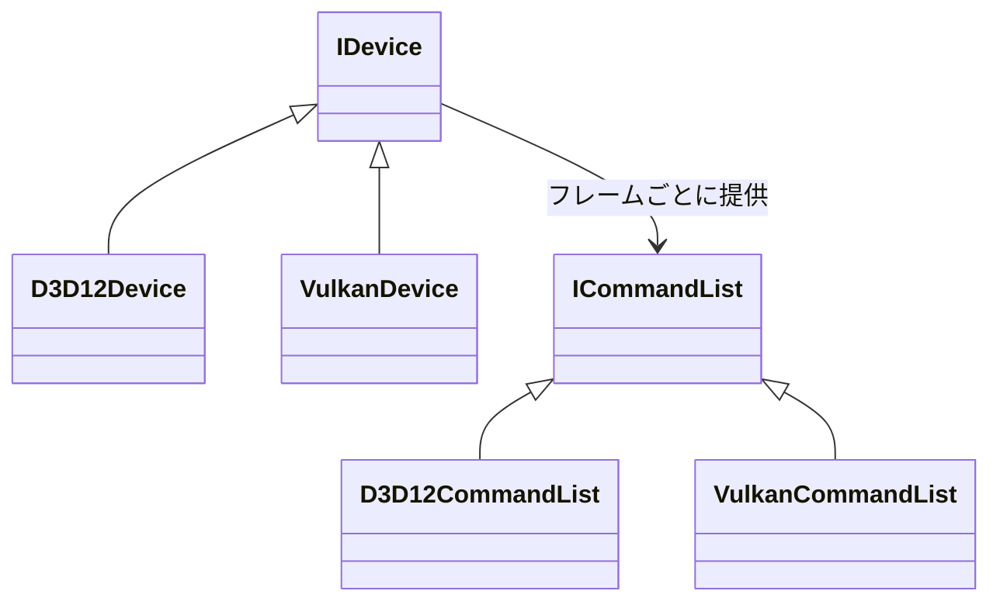

DirectX 12 と Vulkan を同じ API で扱うための層です。

### 抽象化の粒度を「薄く」に決めた

DirectX 12 と Vulkan は、コマンドバッファ・明示的同期・ディスクリプタ管理という点で世代が揃っているため、共通の抽象を置けます。

方針として **RHI 自体は賢くしない**ことに決めました。Device / Queue / CommandList / Pipeline / DescriptorSet / Resource / Barrier を両APIとほぼ1対1で表現するに留め、バリアやディスクリプタの自動化は RHI に入れず、上位のレンダグラフ層の仕事と決めました（レンダグラフ側の自動化はこれからです）。

抽象インターフェースと、各バックエンドの実装の関係です。

厚い抽象（OpenGL 風に隠蔽する形）は採りませんでした。Nexus は明示的APIの性能を引き出すことを目標にしているので、バリアやメモリ配置を RHI の中で隠すと、上位層から最適化する手段がなくなるためです。DX11 / OpenGL 世代まで対応する案も、抽象化の最小公倍数が古い世代に引きずられるため却下しています。

### シェーダは HLSL に統一

シェーダは HLSL で統一して書き、DXC で DXIL（DX12用）と SPIR-V（Vulkan用）の両方へオフラインコンパイルします。シェーダコンパイラだけは、自作が非現実的なためフルスクラッチ方針の例外としています。

### 実装順は Vulkan から

機能追加は「Vulkan 実装 → DX12 実装 → 共通テスト」の順で進めています。Nexus の RHI の範囲では、レイアウト遷移や同期の書き方は **Vulkan のほうが要求が細かいので、Vulkan で通した設計を DX12 へ移すほうが手戻りが少ない**と判断したためです。逆順だと、DX12 で通る緩い設計を Vulkan 側で作り直すことになります。

### CI での実描画

CI は DirectX 12 と Vulkan の両方で、実際に描画して確かめます（ADR 018）。GPU のないランナーでは、DirectX 12 は WARP、Vulkan は Mesa の lavapipe というソフトウェアの実装を使います。

きっかけは、3D 描画が数か月壊れていたのに、ユニットテストが全部緑だったことです。画素を一度も見ていなかったため、誰も気づきませんでした。片方のバックエンドだけを検証しても、「片方だけ壊れる」不具合の半分は見逃します。

Vulkan のほうは遅いので、全ターゲットではなく代表の 3 つに絞っています。ソフトウェアのアダプタは、許可したときだけ候補に入れ、ハードウェアがあれば常にそちらを選びます。セットアップの失敗は、必ず終了コードに出します。「機能が有効なら確認する」と書くと、検知したい失敗そのものが検査を黙らせるためです。
