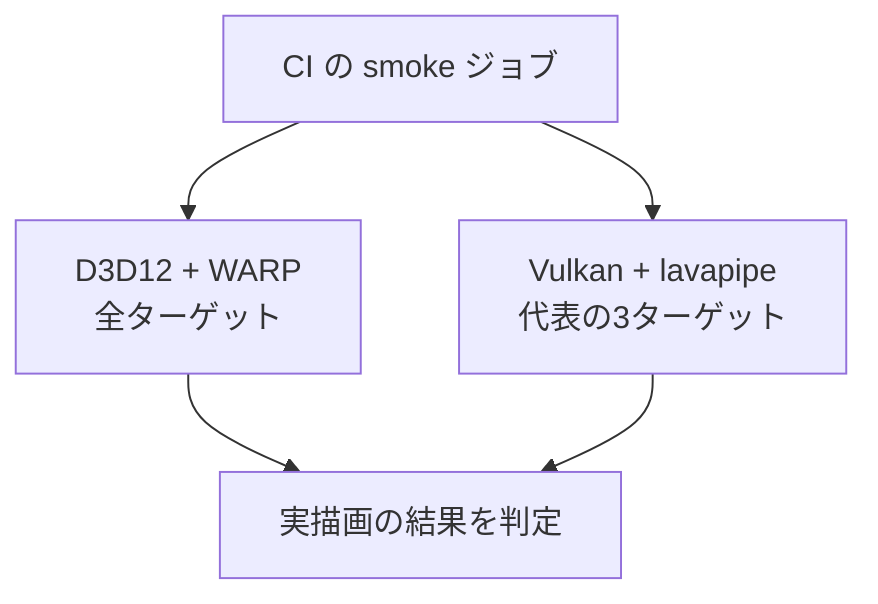

CI は DirectX 12 と Vulkan の両方で、実際に描画して画素を確かめます (ADR 018)。GPU のないランナーでは、DirectX 12 は WARP、Vulkan は Mesa の lavapipe というソフトウェアの実装を使います。

### 仕組み

きっかけは、3D 描画が数か月壊れていたのに、ユニットテストが全部緑だったことです。行列のパッキング不一致、深度の二重反転、Vulkan の Y フリップの欠落が重なっていました。画素を一度も見ていなかったため、誰も気づきませんでした。

最初に DirectX 12 の WARP で実描画できるようにしましたが、これは片方だけです。Vulkan は CI で一度も描画していませんでした。実際に「片方だけ壊れる」事故が起きています。

- DirectX 12 だけ: 頂点バッファのストライドが PSO に焼き込まれる順序契約、動的バッファの SRV スロット不足による交互フレームの破損
- Vulkan だけ: 負のビューポートによる Y フリップ、サンプラーの `maxLod` の既定値でミップが無効になる問題、最小化時のスワップチェーン再生成の失敗

片側だけの検証は、この症状の半分に対して無力です。そこで、Vulkan も CI で描画させます。



Vulkan のほうは CPU 実行で遅いため、全ターゲットではなく代表の 3 ターゲットに絞っています。DirectX 12 の側は、従来どおり全ターゲットを回します。

### 実装

実行ファイルには共通の引数があります。`--smoke` は 120 フレームを描いて終了し、`--warp` はソフトウェアアダプタを許可します。CI は Vulkan を `--vulkan --warp` で起動します。

```cpp
// Engine/Runtime/Src/Application.cpp
if (softwareAdapterRequested)
{
    config.allowSoftwareAdapter = true;
    // ...
    if (!explicitBackend)
    {
        config.backend = rhi::Backend::kD3D12;
    }
}
```

`allowSoftwareAdapter` は、両バックエンドで等しく効きます。ゲームが気づかないうちにソフトウェア描画で動くのを防ぐためのフラグで、オフが既定です。Vulkan も、CPU 種別の物理デバイスを、このフラグが立っているときだけ候補に入れます。ハードウェアがあれば、常にそちらを優先します。

RHI にはセルフテストもあります。次は Radeon RX 9070 での実行結果です (Vulkan)。

```text
[Info][LogRHI] Vulkan inline ray query: enabled
[Info][LogRHI] Vulkan storage image write without format: enabled
[Info][LogRHI] Initialized Vulkan device: AMD Radeon RX 9070
[Info][LogApplication] RHI device created on: AMD Radeon RX 9070 (Vulkan)
[Info][LogRhiSelfTest] RHI self-test: bindlessBufferReuse=true finalReuseIndex=0 storageWrite=true storageSample=true volume=true volumeValidation=true bgraReadback=true patchRegion=true [PASS]
```

### 設計判断

セットアップの失敗は、必ず終了コードに出します。`continue-on-error` を使わず、「機能が有効なら確認する」という書き方もしません。検知したい失敗そのものが、検査を黙らせるからです。実際に、Clustered Forward+ とモーションベクタが、生成に失敗して無効化されたまま CI が緑になった事故があります。

却下した案は次のとおりです。

- **SwiftShader**: Windows 向けの公式プリビルドがなく、CI でソースからビルドすると数十分かかる
- **実 GPU のセルフホストランナー**: 忠実度は最も高いが、個人開発の規模では管理コストと可用性が合わない。実 GPU での確認はローカルで行う
- **Vulkan を CI 対象から外したまま**: 片側だけの検証で通してきた結果が、3D 描画が数か月壊れた事故だった
- **lavapipe が満たさない機能の要求を緩める**: 検証のためにエンジンの要求を下げるのは本末転倒。満たせないなら Vulkan のスモークは落ちるべき

### 限界

- CI が使うのはソフトウェアのラスタライザです。実 GPU での確認は、従来どおりローカルで行います。
- lavapipe は Mesa の配布物から CI のジョブが展開して使います。配布物の構造が変わると、ステップが失敗します (展開したツリーをログに出して落ちます)。
