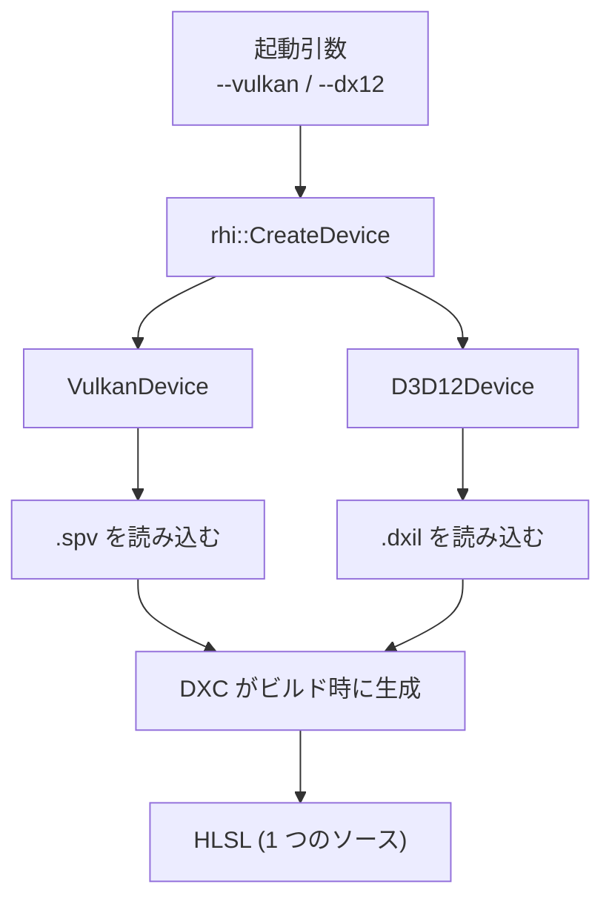

DirectX 12 と Vulkan の 2 つの描画 API を、実行時に選んで同じレンダラから使えるようにしています。上の層のコードは、どちらのバックエンドで動いているかを意識しません。

### 仕組み

どちらの API も、コマンドバッファ・明示的な同期・ディスクリプタ管理という点で世代が揃っています。そのため、共通のインターフェース (`IDevice` / `ICommandList` / `ISwapchain`) を置き、その後ろに `VulkanDevice` と `D3D12Device` を並べています。



バックエンドは `ParseCommonAppArgs` が読む引数 (`--vulkan` / `--vk`、`--dx12` / `--d3d12`、`--backend <名前>`) で決まります。`CreateDevice` は、選ばれたバックエンドの生成関数を呼ぶだけです。

```cpp
// Engine/RHI/Src/RHI.cpp
switch (backend)
{
case Backend::kVulkan:
    return CreateVulkanDevice(desc);
case Backend::kD3D12:
    return CreateD3D12Device(desc);
}
```

DirectX 12 を選んだ端末で非対応 (`kUnsupported`) だった場合、`Application` は警告を出して Vulkan にフォールバックします。ただし、ソフトウェアラスタライザ (`--warp`) を明示した場合は、Vulkan に切り替えても意味がないので、フォールバックしません。

```cpp
// Engine/Runtime/Src/Application.cpp
if (!createdDevice && m_backend == rhi::Backend::kD3D12 &&
    !m_config.allowSoftwareAdapter &&
    createdDevice.Error() == rhi::RHIError::kUnsupported)
{
    NX_LOG_WARN(LogApplication,
                "DX12 backend unsupported on this machine; falling back to Vulkan");
    m_backend = rhi::Backend::kVulkan;
    createdDevice = rhi::CreateDevice(m_backend, deviceDesc);
}
```

`--warp` は、単独で指定すると D3D12 の WARP を選びます。`--vulkan` と一緒に指定すると、Vulkan のままソフトウェアデバイスを許可するだけです。引数の並び順で意味が変わらないよう、全引数を読んでから解決します。

同じ LightingStudio を、起動引数だけ変えて撮影しました。起動ログには、それぞれ `RHI device created on: AMD Radeon RX 9070 (Vulkan)` と `(DX12)` と出ています。

<figure>
  
  <figcaption>Vulkan（--vulkan）。別々に起動して撮影したので、動いている物体の位置は完全には一致しません。</figcaption>
</figure>

<figure>
  
  <figcaption>DirectX 12（--dx12）。シェーダは同じ HLSL から作っています。</figcaption>
</figure>

### 設計判断

ADR 002 で決めました。

- **Vulkan を先に実装する**: 機能追加は「Vulkan 実装、DX12 実装、共通テスト」の順です。レイアウト遷移や同期は Vulkan のほうが要求が細かく、Vulkan で通した設計を DX12 へ移すほうが手戻りが少ないためです。逆順だと、DX12 で通る緩い設計を Vulkan 側で作り直すことになります。
- **DX11 / OpenGL 世代には対応しない**: 抽象の最小公倍数が古い世代に引きずられ、明示的 API の性能が出ないためです。
- **実行時に選ぶ**: 起動引数で切り替えます。`AppConfig` の既定値は Vulkan です。ただし NightCrossing、LightingStudio、WaterSurface のサンプルは、引数の解析の前に DirectX 12 を既定に設定しています。

片方のバックエンドだけが壊れる不具合は、実際に何度も起きています。そのため CI では両方を実際に描画して確かめます。

### 限界

- ADR 002 には「Windows は DX12 既定」とありますが、`AppConfig` の既定値は Vulkan で、アプリごとに違います。
- Linux 対応は、ADR 001 の改訂で撤回されています (ADR 002 に取り消し線で残っています)。
