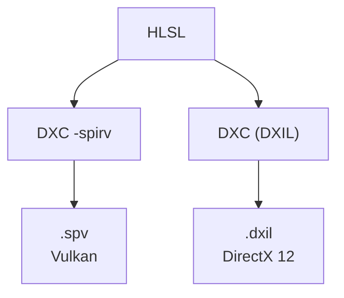

シェーダは HLSL を 1 つのソースで書き、DXC で DXIL (DirectX 12 用) と SPIR-V (Vulkan 用) の両方へオフラインでコンパイルします。バックエンドごとにシェーダを書き分けません。シェーダコンパイラだけは、自作が非現実的なため、フルスクラッチ方針の例外としています (ADR 002、ADR 004)。

### 仕組み

ビルドでは、1 つの HLSL ファイルとエントリポイントから、2 つの成果物を出します。CMake の関数 `nx_compile_hlsl` が、同じソースに対して DXC を 2 回呼びます。



実行時は、使っているバックエンドに応じて拡張子を選んで読み込みます (`dxil` か `spv`)。

```cmake
# Shaders/CMakeLists.txt
COMMAND ${NX_DXC_EXECUTABLE}
        -T ${PROFILE} -E ${ENTRY}
        -spirv -fspv-target-env=vulkan1.3 -fspv-entrypoint-name=${SPV_ENTRY_NAME}
        -WX -Zi -Fo ${SPV_OUTPUT}
        ${CMAKE_CURRENT_SOURCE_DIR}/${SOURCE}
```

SPIR-V 側では、エントリポイントの名前を `VSMain` / `PSMain` / `CSMain` に付け替えます。Vulkan バックエンドが、ステージごとに決まった名前でシェーダを作るためです。DXIL は名前を見ずにステージで引くので、1 つのファイルに同じステージの複数のエントリを置けます。

### 実装

リソースの宣言は `Shaders/Bindless.hlsli` に集めています。同じ宣言が、Vulkan では `set 0` のバインディングに、DirectX 12 ではレジスタ空間に対応します。

```hlsl
// Shaders/Bindless.hlsli
[[vk::binding(0, 0)]] Texture2D        gTextures[] : register(t0, space0);
[[vk::binding(1, 0)]] SamplerState     gSampler    : register(s0, space0);
[[vk::binding(2, 0)]] ByteAddressBuffer gBuffers[] : register(t0, space1);
```

プッシュ定数は、`__spirv__` が定義されているかどうかで書き分けます。Vulkan ではプッシュ定数、DirectX 12 ではルート定数になります。

```hlsl
// Shaders/Bindless.hlsli
#ifdef __spirv__
#define NX_PUSH_CONSTANTS(Type, name) [[vk::push_constant]] Type name;
#else
#define NX_PUSH_CONSTANTS(Type, name) ConstantBuffer<Type> name : register(b0, space0);
#endif
```

頂点入力は、`TEXCOORD<location>` のセマンティクスと、明示した `[[vk::location(N)]]` に統一しています。RHI の location 番号で決まる頂点レイアウトが、両 API で一致します。

### 設計判断

- **バックエンドごとに別の HLSL を書かない**: 二重のメンテナンスになるためです。DXC の 2 通りの出力で足ります (ADR 009)。
- **独自のシェーダ言語は作らない**: ADR 002 では、後期の検討事項として保留しています。
- **DXC はフルスクラッチ方針の例外**: 自作が非現実的なためです。

### 限界

- コンパイルはビルド時のオフラインです。
- レイトレース用のバインディング (加速構造) は、`NX_RAY_QUERY` を定義したコンピュートシェーダだけが使えます。使えるのは、`DeviceCaps::rayQuery` が真のデバイスだけです。
