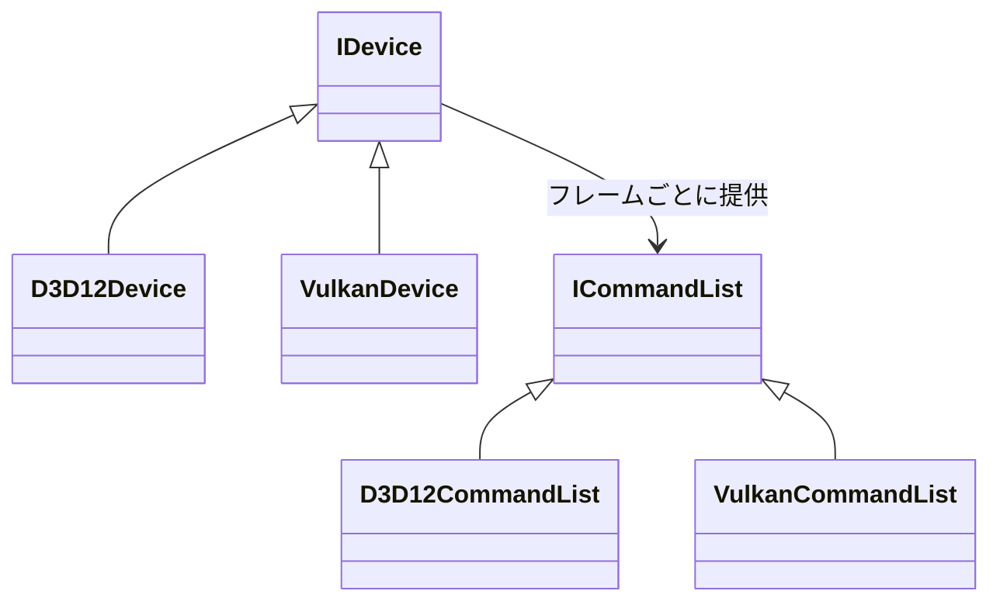

DirectX 12 と Vulkan は、コマンドバッファ・明示的同期・ディスクリプタ管理という点で世代が揃っているため、共通の抽象を置けます。Nexus の RHI (Render Hardware Interface) は、その共通部分だけを薄く切り出したものです。

### 仕組み

方針は **RHI 自体は賢くしない**ことです。両 API の概念をほぼ 1 対 1 で表し、バリアの自動化のような賢い処理は RHI に入れません。それは上位のレンダグラフ層の仕事と決めました (ADR 002)。レンダグラフは、パスの順序とリソースの使われ方から、描画の流れを組む層です。

抽象インターフェースと、各バックエンドの実装の関係です。



### 実装

公開されているのは `IDevice`、`ICommandList`、`ISwapchain` と、リソースを指すハンドル (`BufferHandle`、`TextureHandle`、`PipelineHandle`、`AccelStructHandle`) です。フレームの流れは、`BeginFrame`、`FrameCommandList()`、`EndFrame` です。

```cpp
// Engine/RHI/Include/Nexus/RHI/Device.h
virtual Result<void, RHIError> BeginFrame(ISwapchain& swapchain) = 0;

// Valid between a successful BeginFrame() and EndFrame().
virtual ICommandList& FrameCommandList() = 0;

// Submits the frame command list and presents.
virtual Result<void, RHIError> EndFrame(ISwapchain& swapchain) = 0;
```

薄い、といっても、重複をなくす処理は入っています。同じ内容のパイプラインを作ると、同じハンドルが返り、内部の参照カウントが増えます。

```cpp
// Engine/RHI/Include/Nexus/RHI/Device.h
// Pipelines are deduplicated through a hash cache (design 03 section 1):
// creating an identical desc returns the same handle with an incremented
// internal refcount; DestroyPipeline releases one reference.
virtual Result<PipelineHandle, RHIError>
CreateGraphicsPipeline(const GraphicsPipelineDesc& desc) = 0;
```

定数やライトのデータは、専用の定数バッファ API ではなく、バインドレスなストレージバッファで渡します。バッファに振られた番号を、128 バイトのプッシュ定数に入れて、シェーダが配列から引きます (ADR 009)。

### 設計判断

- **厚い抽象 (OpenGL 風の隠蔽) は採らない**: バリアやメモリ配置を RHI の中で隠すと、上位層から最適化する手段がなくなるためです。商用レベルの性能要件と矛盾します。
- **DX11 / OpenGL 世代には対応しない**: 抽象化の最小公倍数が古い世代に引きずられるためです。
- **専用の定数バッファ束縛 API を作らない**: バインドレスと二重管理になるため、ストレージバッファのバインドレスに統一しました (ADR 009)。

### 限界

- ADR 002 は、Device / Queue / CommandList / Pipeline / DescriptorSet / Resource / Barrier を 1 対 1 で表すと書いています。実際の公開 API には、`Queue`、`DescriptorSet`、`Barrier` に当たる型がありません。バリアはバックエンドの内部で扱い、ヘッダには「公開のバリア API はレンダグラフと一緒に現れる」という注記が残っています。ディスクリプタは、バインドレスのインデックスで扱います。
- `Device.h` の冒頭の注記では、グラフィックスキューは 1 本で、コマンドリストはフレームに 1 つです。並列記録、コンピュート / コピー専用のキュー、タイムラインセマフォは、レンダグラフの段階で入れるとあります。
