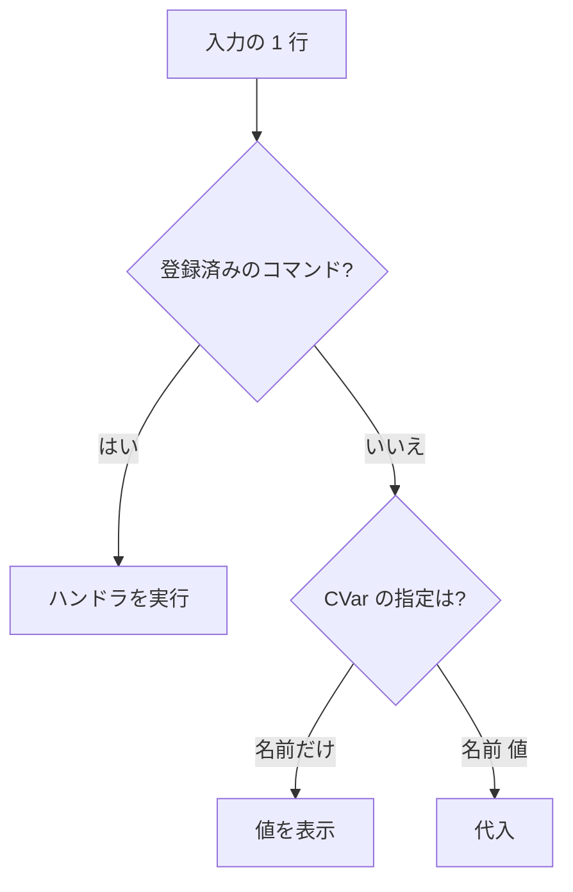

動いているゲームに、実行中にコマンドや設定変更を送る手段です。画面に出すコンソール(`DebugConsole`)と、外部のツールから TCP でつなぐリモートコンソール(`RemoteToolServer`)に分かれています。`DebugConsole` は描画に依存せず、ヘッドレスでテストできます。

### コンソール本体

`DebugConsole` は次を持ちます。

- コマンドの登録と実行。同じ名前で登録し直すと、ハンドラが置き換わります。
- CVar(実行中に変えられる設定値)の確認と変更。
- ログの履歴。最小の重大度を指定し、それ以上のログを取り込みます。行は最大 512 行です。
- 入力履歴(最大 128 件)。古い方、新しい方へたどれます。
- 前方一致の補完。コマンドと CVar の名前が候補です。

`Execute` は 1 行を、まず登録済みのコマンドとして探し、なければ CVar として扱います。CVar は名前だけなら値を表示し、`名前 値` なら代入します。入力した行はそのまま履歴に残り、画面にも戻して表示します。標準で `help`、`clear`、`cvarlist` が入っています。

`Execute` が 1 行を処理する流れです。



### リモートコンソール

動いているゲームが TCP のサーバになり、外部のツールがつないで次の 3 種類を頼めます。

| 要求 | 内容 |
| --- | --- |
| `kExecuteCommand` | コンソールのコマンド実行 |
| `kRequestStats` | 統計の取得(1 行 `name=current,avg`) |
| `kRequestProfile` | プロファイルの要約の取得 |

要求は 128 未満、応答は 128 以上の番号で区別します。メッセージは 1 バイトの種類、4 バイトの長さ(リトルエンディアン)、本体の順に並べた単純な枠です。現在の本体は UTF-8 の文字列ですが、バイナリも通せる枠にしてあり、telnet でも確認できます。

```cpp
// Engine/Runtime/Include/Nexus/Runtime/RemoteConsole.h
    enum class RemoteMessage : u8
    {
        kExecuteCommand = 1, // payload: command line text
        kRequestStats   = 2, // payload: empty
        kRequestProfile = 3, // payload: empty

        kCommandOutput  = 128, // payload: console output produced by the command
        kStatsSnapshot  = 129, // payload: "name=current,avg" per line
        kProfileSnapshot = 130, // payload: profiler summary text
    };
```

枠の組み立てと解釈はソケットから切り離してあり、一部しか届いていないバッファは「まだ足りない」として扱います(位置を進めません)。ゲーム側は `Poll` をフレームに 1 回呼び、接続の受け付け、要求の読み取り、応答の書き込みをします。アプリは `SetExtraProfileText` で、描画パスごとの GPU 時間のような文字列をプロファイルの応答に足せます。

### 使われ方と限界

- Sandbox は `DebugConsole` を持ち、ImGui で画面に出します。`--tools-port <n>` を付けたときだけ `RemoteToolServer` を起動します。
- ツール側の `RemoteToolClient` はあります。ただし、使っているのは Runtime のテストだけで、エディタや CLI からは呼ばれていません。
- 送信は、小さなメッセージをローカルのツール接続で送る前提で、回数を決めた再試行で送りきります。大きなデータを流す用途の作りではありません。
- 認証はなく、待ち受けは全ネットワークインターフェース(`INADDR_ANY`)に対して開きます。
