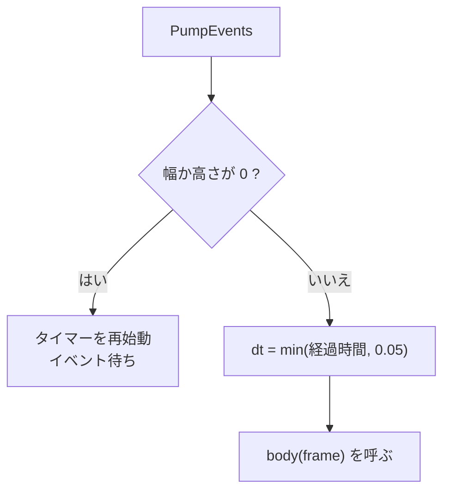

アプリの起動、メインループ、フレームごとの時間管理をまとめます。デモやサンプルが同じ起動処理とループを使うことで、ウィンドウ、デバイス、スワップチェーンの用意と後始末を毎回書かずに済みます。

### 起動

`Application::Initialize` は次の順で進めます。

1. ログを初期化する。
2. 設定が有効なら、クラッシュハンドラを入れる。出力先は既定で `out_crash_dumps`。
3. ウィンドウを作る。
4. 指定したバックエンドで RHI のデバイスを作る。DX12 が非対応のマシンでは Vulkan に切り替える(ただし D3D12 のソフトウェア描画を明示したときは切り替えない)。
5. ウィンドウの大きさが 0 のあいだ、スワップチェーンの作成を待つ。最小化された状態で起動されると、起動直後の幅と高さが 0 になるためです。
6. スワップチェーンを作る。

起動オプションのうち、全デモで共通のものは `ParseCommonAppArgs` が解釈します。`--vulkan`、`--dx12`、`--backend`、`--warp`(GPU がない環境でのソフトウェア描画)、`--adapter=<n>`、`--validation`、`--no-vsync`、`--smoke`(120 フレームで終了)です。`AppConfig` の既定のバックエンドは Vulkan です。

### メインループ

`RunLoop` に、1 フレームぶんの処理を渡します。毎フレーム、イベントを処理し、経過時間を測って処理を呼びます。



```cpp
// Engine/Runtime/Include/Nexus/Runtime/Application.h
            f32 dt = static_cast<f32>(frameTimer.Elapsed().Seconds());
            if (dt > kMaxDeltaSeconds)
            {
                dt = kMaxDeltaSeconds;
            }
            frameTimer.Restart();

            FrameInfo frame;
            frame.dt = dt;
            frame.time = static_cast<f32>(runTimer.Elapsed().Seconds());
            frame.index = m_frameCount;
            frame.smoke = m_config.smokeFrames != 0;

            body(frame);
```

経過時間は 0.05 秒(20 FPS 相当)で打ち切ります。長いフレームのあとに、シミュレーションが一度に大きく進むのを防ぎます。最小化されて大きさが 0 のあいだは、`body` を呼ばずにイベントを待ちます。タイマーも再始動するので、復帰した最初のフレームの `dt` に最小化していた時間は入りません。

### 固定ステップ: `FrameScheduler`

更新の順序づけには `FrameScheduler` があります。処理(システム)を `PreUpdate`、`FixedUpdate`、`Update`、`LateUpdate` の 4 つのグループに登録します。グループの中では、`order` の小さい順、同じ値なら登録した順に呼びます。`FixedUpdate` は固定の時間刻み `h`(既定は 1/60 秒)で、経過時間に応じた回数だけ呼びます。

```math
a \leftarrow a + \Delta t;\quad
\text{while } a + \varepsilon \ge h \text{ and } n < 8:\ a \leftarrow a - h,\ n \leftarrow n + 1
```

`a` は溜めた時間、`n` は今回のフレームで実行した回数、`ε` は 10⁻⁷ です。1 フレームの実行は 8 回までで、8 回で打ち切って `a` がまだ `h` 以上のときは `a` を 0 にします。長い停止のあと、固定ステップが際限なく追いかけ続ける状態を避けるためです。直近の回数は `LastFixedStepCount` で取れます。

```cpp
// Engine/Runtime/Src/FrameScheduler.cpp
        m_fixedAccumulator += dt;
        while (m_fixedAccumulator + kAccumulatorEpsilon >= m_fixedTimestep &&
               m_lastFixedStepCount < kMaxCatchupSteps)
        {
            ExecuteGroup(TickGroup::kFixedUpdate, m_fixedTimestep);
            m_fixedAccumulator -= m_fixedTimestep;
            if (m_fixedAccumulator < kAccumulatorEpsilon)
            {
                m_fixedAccumulator = 0.0f;
            }
            ++m_lastFixedStepCount;
        }
```

### 使われ方と限界

`FrameScheduler` は `Application` のループとは独立したクラスで、`RunLoop` からは呼ばれません。使っているのは Sandbox の `FrontendDemo`(`--frontend` で有効)だけです。そこでは、タイトルからメニュー、設定、ゲーム、ポーズへ進む画面のデモの中で、固定ステップ(1/60 秒)の回数を数えるために `SetFixedTimestep`、`Tick`、`LastFixedStepCount` を呼んでいます。システムの登録(`AddSystem`)は、ソースを検索した範囲では、Runtime のテスト以外にありません。グループ分けと並び順の機能は、実際のゲームではまだ使われていません。
