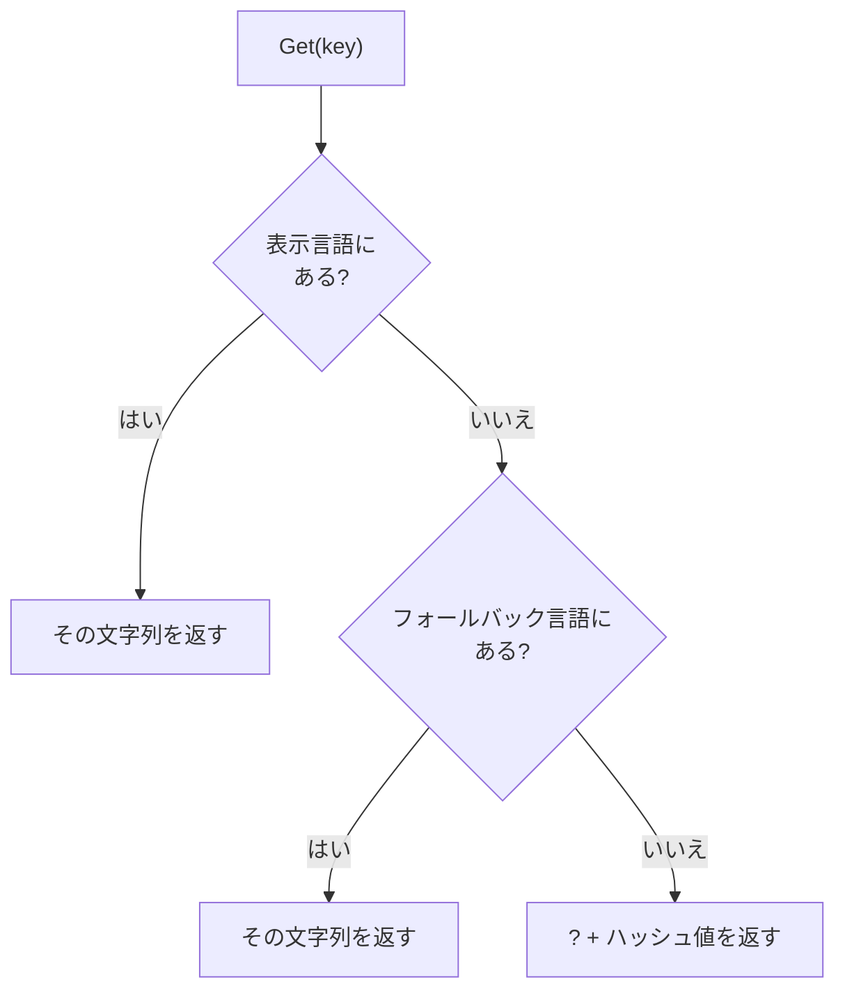

画面に出す文字列を、コードに直接書かずにキーで引くための表です。言語を切り替えると、同じキーから別の文字列が返ります。

### 仕組み

`LocalizationTable` は、言語ごとに「キー → 文字列」の表を持ちます。キーは `StringId`(文字列から作る ID)で、表の中では ID のハッシュ値で引きます。

指定できる言語は 2 つあります。

- 表示する言語(`SetLanguage`)
- 足りないときのフォールバック言語(`SetFallbackLanguage`)

`Get(key)` は、表示する言語で探し、なければフォールバック言語で探します。どちらにもなければ、`?` に続けてキーのハッシュ値を並べた文字列を返します。キーの付け忘れが画面に出るので、気づけます。



```cpp
// Engine/Runtime/Src/Localization.cpp
        if (const char* text = FindString(m_language, key))
        {
            return text;
        }

        if (m_fallbackLanguage != m_language)
        {
            if (const char* text = FindString(m_fallbackLanguage, key))
            {
                return text;
            }
        }

        m_missingBuffer.Assign("?");
        m_missingBuffer.AppendU64(key.Hash());
        return m_missingBuffer.CStr();
```

### 使い方

Sandbox の `FrontendDemo` は、日本語と英語の文字列を登録し、英語をフォールバックに、日本語を表示言語にしています。画面に出す文字列はすべてキー(`ui.title`、`ui.start` など)で引きます。設定画面で言語を切り替えると、全画面の文字がすぐに変わります。

```cpp
// Sandbox/FrontendDemo.cpp
        m_strings.SetFallbackLanguage(kLanguageEn);
        m_strings.SetLanguage(kLanguageJa);
```

### 限界

- 文字列はコード内に直接登録しています。ファイルから読み込む処理はこのモジュールにありません。デモのコメントは、出荷するタイトルではデータから読む想定だと述べています。
- 数や名前を埋め込む書式、複数形、右から左へ書く言語への対応はありません。
- `Get` が返すポインタは、表の中の文字列か、表が持つ 1 つの共有バッファです。見つからなかったときのバッファは次の `Get` で書き換わるので、保持し続けられません。
- 使っているのは、Sandbox の `FrontendDemo` と Runtime のテストだけです。
