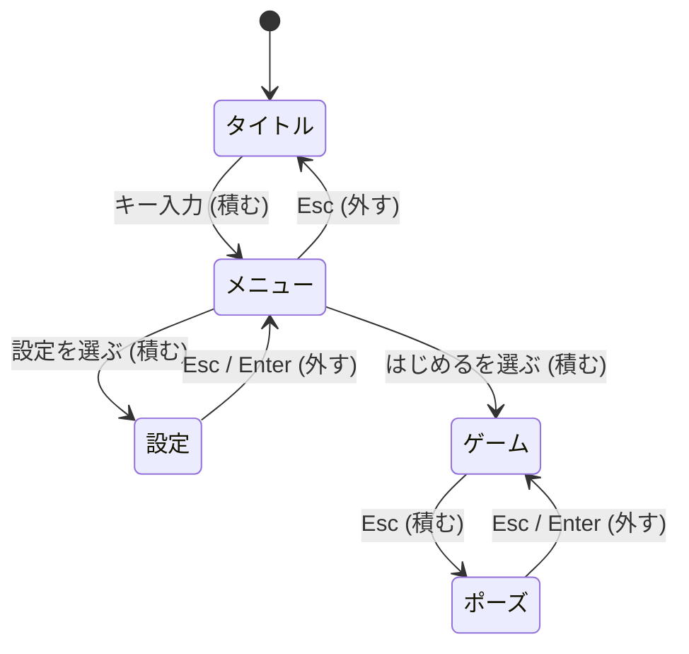

起動、メニュー、プレイ、ポーズといったゲームの大きな流れと、画面の重なりを別々の部品で扱います。流れは状態機械の `GameFlow`、画面は積み重ねの `ScreenStack` です。

### 仕組み

`GameFlow` は、状態の一覧と、トリガーで遷移する表を持つ平らな状態機械です。状態には入るときと出るときのコールバックを付けられます。`Fire(trigger)` は表を登録順に見て、最初に合った遷移を実行します。遷移元に `-1` を指定すると「どの状態からでも」の意味になります。

```cpp
// Engine/Runtime/Src/GameFlow.cpp
    bool GameFlow::Fire(StringId trigger)
    {
        for (usize i = 0; i < m_transitions.Size(); ++i)
        {
            const Transition& t = m_transitions[i];
            if (t.trigger != trigger)
            {
                continue;
            }
            if (t.from != -1 && t.from != m_current)
            {
                continue;
            }
            // ...
            m_current = t.to;
            // ...
            return true;
        }
        return false;
    }
```

`ScreenStack` は、画面を積む(`Push`)、外す(`Pop`)、置き換える(`Replace`、外してから積む)の 3 操作を持ちます。画面ごとに入ったとき、出たとき、更新のコールバックを渡せます。更新は一番上の画面だけに届きます。ポーズ画面をゲーム画面の上に積めば、下のゲーム画面は積まれたまま止まる、という使い方になります。

```cpp
// Engine/Runtime/Src/ScreenStack.cpp
    void ScreenStack::Pop()
    {
        if (m_stack.IsEmpty())
        {
            return;
        }

        const ScreenCallbacks callbacks = m_stack[m_stack.Size() - 1u].callbacks;
        if (callbacks.onExit != nullptr)
        {
            callbacks.onExit(callbacks.user);
        }

        m_stack.Pop();
    }
```

### Sandbox での使い方

Sandbox の `FrontendDemo`(`--frontend` で有効)が、この 2 つの唯一の利用者です。画面は ScreenStack に積み、`GameFlow` には 2 つの状態(タイトル、ゲーム)と、`ui.startGame` で移る遷移を 1 つだけ登録しています。ゲームの時間の進み方を画面の処理に混ぜないため、というコメントがあります。



画面に入るたびに、透明度を 0 から 1 へ 0.35 秒かけて動かします(外すときは 0.2 秒)。この動きには `UiAnim` の `Tween` を使っています。

```cpp
// Sandbox/FrontendDemo.cpp
    void FrontendDemo::PushScreen(FrontendScreen screen)
    {
        nx::ScreenCallbacks callbacks;
        m_screens.Push(ScreenId(screen), callbacks);
        ++m_screenChanges;

        // Every screen entry fades in; the tween is what actually drives the alpha the
        // renderer reads, rather than an ad-hoc timer in the update loop.
        m_fade.Start(0.0f, 1.0f, 0.35f);
    }
```

### 限界

- `ScreenStack` と `GameFlow` を使っているのは、このデモと Runtime のテストだけです。Samples、Server、Editor、Tools を検索した範囲に、ほかの利用者はありません。
- デモのコールバックは、画面ごとのものを渡さず空のままです。`GameFlow` の入退場のコールバックも使っていません。
- 画面の入退場を演出する仕組みは、`Tween` を手で組み合わせる形です。画面の遷移そのものにアニメーションを持たせる機能は `ScreenStack` にはありません。
