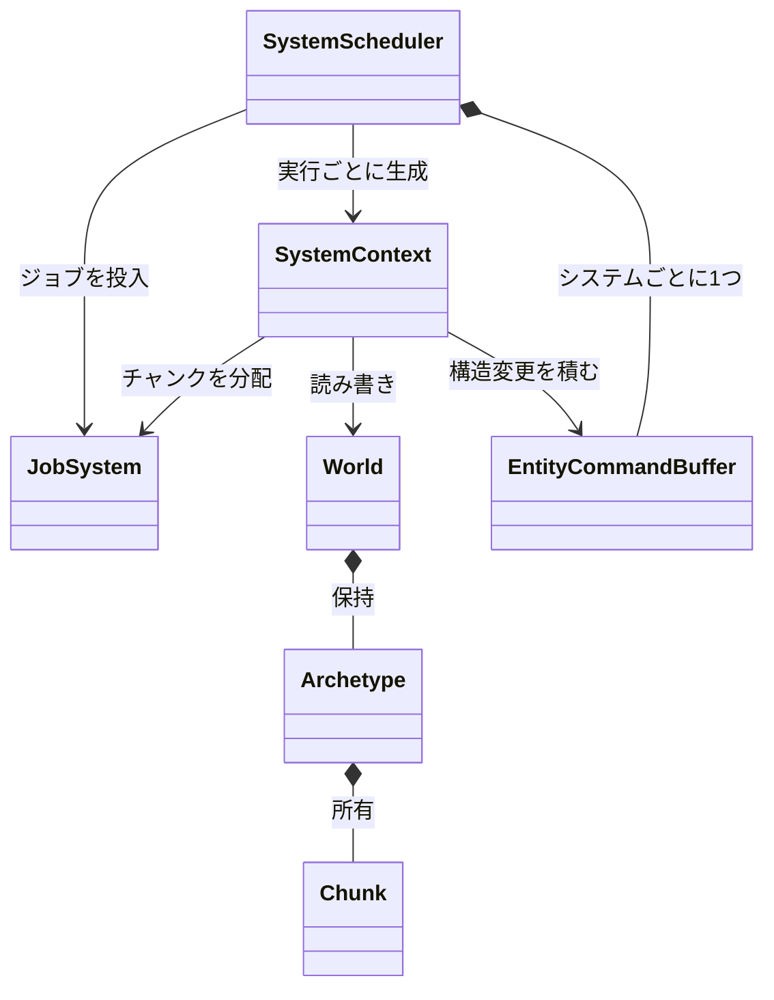
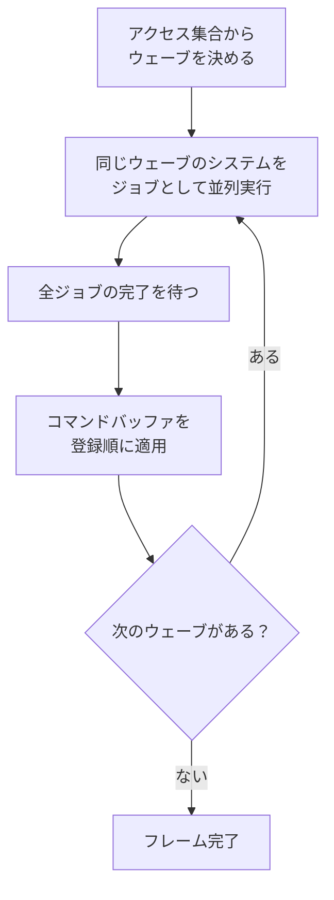

ゲームの状態を持つ中核です。エンティティとコンポーネントのストレージ、システムの並列実行、空間検索、シーンの保存を担当します。

### 並列ECS — 衝突をコードに宣言させる

#### 解きたかった問題

ECS のストレージはアーキタイプ方式で並列化に向いた形でしたが、走査が1エンティティ単位しかなく、仕事をジョブに切り出す単位がありませんでした。

素朴に「システムを全部ジョブに投げる」と、同じコンポーネントを触るシステム同士がデータ競合します。そして**競合の有無を人間が管理する方式は、システムが増えたときに必ず破綻します**。

さらにオンライン対戦のために決定論シミュレーションが必要で、並列化しても実行ごとに結果が変わってはいけないという条件がありました。スレッドの実行順が結果に漏れる余地を、設計で塞ぐ必要があります。

#### 採った方法

システムが触るコンポーネントを、型で宣言させることにしました。

NexusDefense で実際に登録しているコードです。

```cpp
// Samples/TowerDefense/Core/TdSystems.cpp
scheduler.Add<nx::Reads<TdPosition, TdEnemyStats, TdLagState>,
              nx::Writes<TdVelocity>>(
    "TD/EnemyAI", &EnemyAiSystem, &context);
scheduler.Add<nx::Reads<TdVelocity>, nx::Writes<TdPosition>>(
    "TD/Movement", &MovementSystem, &context);
```

アクセス集合はビットセットで保持し、2つのシステムが衝突するのは次のいずれかの場合です。

- `A.writes ∩ B.writes ≠ ∅`
- `A.writes ∩ B.reads ≠ ∅`
- `A.reads ∩ B.writes ≠ ∅`

読み取り同士は衝突しません。判定に**集合の等値性しか使わない**ので、型IDの値が実行ごとに変わっても結果は変わりません。

そのうえで、ウェーブ（段）への割り当てを登録順だけで決めます。

- 衝突するシステム同士は、必ず登録順どおりに実行される
- 同じウェーブのシステムは互いに衝突しないので、実行順に関係なく結果が同じ

この2つから、**並列実行の結果は登録順の直列実行と一致します**。デバッグ用の直列実行パスを用意し、両者が一致することをテストで突き合わせています。

ただしこれが成り立つのは、**システムが宣言したコンポーネントだけを読み書きする**場合です。宣言していないグローバル状態や外部 I/O、システム間で共有する乱数に触れると、スケジューラはその競合を検出できません。そこは保証の外で、システムを書く側が守る制約にしています。

エンティティの生成・破棄といった構造変更は、システムごとのコマンドバッファに積み、ウェーブの境界で呼び出しスレッドが登録順に適用します。どのシステムが先に終わったかは、適用順に影響しません。

主要なクラスの関係です。



1フレームの実行の流れです。



### 空間構造

動く物と動かない物、毎フレーム全部が動く物で、使うデータ構造を分けています。動く物は `AabbTree` で、挿入・削除・更新ができ、箱・視錐台・レイで問い合わせられます。動かない物は `StaticBvh` で、ロードやクックのときに一度だけ、時間をかけて質の高い木を作ります。

2D の近傍探索は 2 つあります。`SpatialGrid2D` は数千個の準静的なプロキシを想定した作りです。数万体が毎フレーム全部動く用途では、ハッシュ引きとセルごとの確保が支配的になったので、毎フレーム作り直す `UniformGrid2D` を別に足しました（ADR 019）。

`UniformGrid2D` は、個別の挿入も削除もなく、数え上げソートで点をセルに束ねるだけです。このソートは安定なので、同じ入力からは同じ順序が出て、決定論シミュレーションを壊しません。クエリは粗い候補の添字だけを返し、正確な判定は呼び出し側に任せます。

### シリアライズ

`SaveScene` / `LoadScene` が、ワールドを JSON に書き出し、読み戻します。ファイルにはバージョンと、エンティティの配列があります。親子関係は、ハンドルではなく配列の番号で持ちます。

保存するコンポーネントは、名前を付けて登録したものだけです。登録の条件は、リフレクションされていて、メモリ上でそのままコピーできる型であることです。GPU のハンドルや物理のボディのような実行時の状態は、保存する側に入れない決まりにしています（ADR 034）。エディタの保存・読み込みと、プレイモードの開始・復元が、これを使っています。
