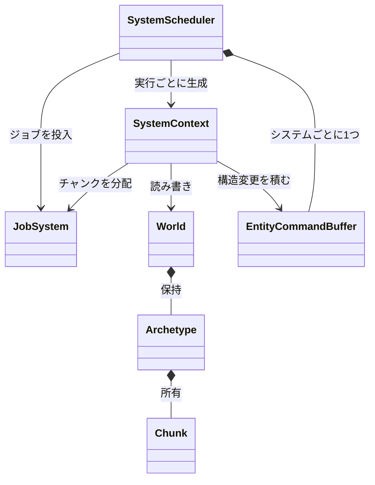

ゲームの状態を `World` に持ち、アーキタイプ方式で連続メモリに並べます。ゲームコードとエディタは `Entity` ハンドルを使い、内部のストレージは見えません。走査の単位はチャンクで、これが仕事をジョブに切り出す単位になります。

<figure>
  <video src="/images/works/nexus/defense-ecs.mp4#t=0.1" controls loop muted playsinline preload="metadata"></video>
  <figcaption>NexusDefense を <code>--enemies 100000 --autoplay</code> で動かした 8 秒の実録 (RX 9070)。右のパネルにエンティティ数と各処理時間が出ています。</figcaption>
</figure>

### 仕組み

同じコンポーネントの組を持つエンティティは、1 つのアーキタイプにまとまります。アーキタイプは 16 KB のチャンクを複数持ち、チャンクの中にはエンティティの配列と、コンポーネントごとの配列 (列) が並びます。1 チャンクに入る行数は、組み合わせたコンポーネントの大きさから決まります。

コンポーネントを追加・削除すると、エンティティは別のアーキタイプへ移ります。走査は「指定した型をすべて持つアーキタイプ」を対象にします。型の組ごとに一致するアーキタイプを覚えておき、アーキタイプが増えたときだけ作り直します。

主なクラスの関係です。



`SystemScheduler` は、システムを実行する仕組みです。システムが触るコンポーネントを宣言させ、衝突しないものを同時に走らせます。詳しくは別のページで扱います。

### 実装

チャンクの容量は、まずエンティティ ID だけで 16 KB を埋めた行数から始め、すべての列を含めたレイアウトが 16 KB に収まるまで 1 行ずつ減らして決めます。

```cpp
// Engine/Scene/Src/World.cpp
usize capacity = kChunkSize / sizeof(Entity);
while (capacity > 0 && LayoutBytesForCapacity(archetype->columns, capacity) > kChunkSize)
{
    --capacity;
}
NX_ASSERT(capacity > 0, "ECS component set does not fit in a 16KB chunk");
archetype->capacity = capacity == 0 ? 1 : capacity;
```

走査の基本形は `ForEachChunk` です。チャンク 1 個につきコールバックを 1 回呼び、エンティティ配列と各コンポーネントの配列ポインタを渡します。`ForEachChunkParallel` は、チャンク 1 個をジョブ 1 個として投入し、全部終わるまで待ちます。

```cpp
// Engine/Scene/Include/Nexus/Scene/World.h
handles.Push(jobs.Submit([&, archetype, chunk]() {
    fn(chunk->entities, chunk->count,
       ComponentArray<Ts>(*chunk, *archetype)...);
}));
```

`ForEachChunkParallel` のコールバックは複数のスレッドで同時に動きます。そのため、次の 3 つがヘッダのコメントで求められています。

- 読み書きを、渡されたチャンクの中に収める
- `Create` / `Destroy` / `Add` / `Remove` を直接呼ばない。変更は `EntityCommandBuffer` に積み、走査のあとで `Apply` する
- チャンクの順序に依存しない。共有の値へ足し込まず、チャンクごとに集計して決まった順で畳む

走査の最中に構造を変えると、`AssertCanChangeStructure` が `NX_ASSERT` で検出します。走査中の深さは原子カウンタで数えています。

コンポーネントは、メモリ上でそのままコピーできる型 (trivially copyable) に限ります。`ValidateComponent` が `static_assert` で確かめます。中身のないタグ型は列を持たず、チャンク走査では配列ポインタが `nullptr` で渡ります。フィルタとしては効きます。

### 設計判断

- **シーングラフ API と ECS ストレージの併用 (ADR 003)**: 外向きは `Entity` と親子階層、内部はアーキタイプです。純 OOP のシーングラフはキャッシュ効率と並列化の限界が早く、階層 API のない純 ECS はエディタや 2D の親子構造が扱いにくいため、どちらも採りませんでした。
- **コンポーネントはロジックを持たない構造体**: ロジックはシステム側に置きます。コンポーネントに仮想の `Update` を持たせる使い方は提供しません (ADR 003)。
- **型 ID は実行ごとに変わりうる (ADR 014)**: `GetComponentTypeId<T>()` は初回呼び出し順の連番です。そのため、アーキタイプ内の列の並びとアーキタイプのキーは、型名から作った安定ハッシュで決めます。ID が実行ごとに違っても、チャンクのレイアウトは変わりません。
- **走査をチャンク単位に一本化 (ADR 015)**: 従来の `ForEach` は `ForEachChunk` の上に実装し直しました。
- **クエリのキャッシュはポインタで持つ**: 走査の入れ子で、内側の最初のクエリがキャッシュの配列を伸ばしても、外側が持つ参照が壊れないようにするためです。

### 限界

- チャンクの大きさは 16 KB 固定です。コンポーネントの組が 1 行で 16 KB を超えると `NX_ASSERT` で止まります。
- システム数の上限は 64、クエリの種類は 256、コンポーネント型は 1024 です。超えると `NX_ASSERT` で止まります。
- コンポーネントはメモリ上でそのままコピーできる型に限ります。文字列やコンテナを直接持たせることはできません。
