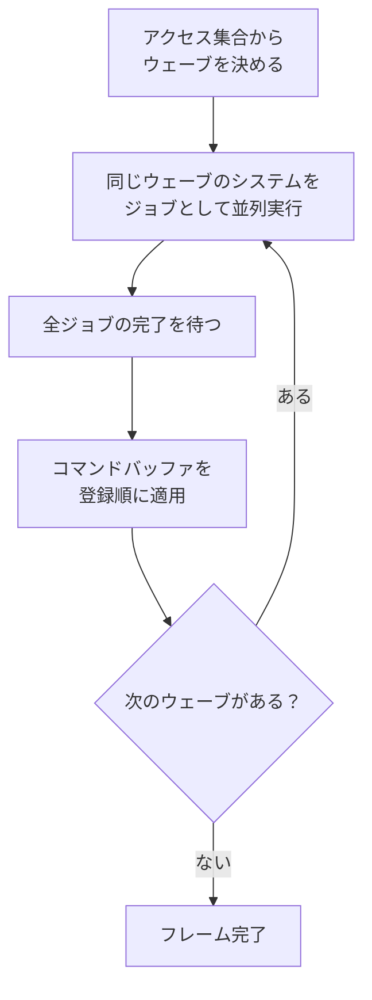

ECS のシステムを複数のスレッドで同時に動かすためのスケジューラです。システムが読み書きするコンポーネントを型で宣言させ、衝突しないものだけを並列に走らせます。結果は、登録順に 1 本ずつ実行したときと一致します。

<figure>
  
  <figcaption>NexusDefense を <code>--enemies 100000 --autoplay</code> で動かした 1 フレーム (RX 9070)。エンティティ 93,318、409 FPS、フレーム 2.44 ms、ECS 11.90 ms。右のパネルに、後述のウェーブごとにシステムが並びます。</figcaption>
</figure>

### 仕組み

素朴に「システムを全部ジョブに投げる」と、同じコンポーネントを触るシステム同士がデータ競合します。競合の有無を人が管理する方式は、システムが増えると破綻します。さらにオンライン対戦のために決定論シミュレーションが必要で、並列化しても実行ごとに結果が変わってはいけません。

そこで、システムの登録時に Reads と Writes を型で宣言させます。実際に NexusDefense が登録しているコードです。

```cpp
// Samples/TowerDefense/Core/TdSystems.cpp
scheduler.Add<nx::Reads<TdPosition, TdEnemyStats, TdLagState>,
              nx::Writes<TdVelocity>>(
    "TD/EnemyAI", &EnemyAiSystem, &context);
scheduler.Add<nx::Reads<TdVelocity>, nx::Writes<TdPosition>>(
    "TD/Movement", &MovementSystem, &context);
```

宣言はビットセット (コンポーネント型 ID をビット位置にしたもの) になります。システム `$A$` の読む集合を `$R_A$`、書く集合を `$W_A$` とすると、2 つのシステムが衝突するのは次のいずれかのときです。

```math
\text{conflict}(A,B) \iff (W_A \cap W_B \neq \emptyset) \lor (W_A \cap R_B \neq \emptyset) \lor (R_A \cap W_B \neq \emptyset)
```

読み取り同士は衝突しません。判定は集合が交わるかどうかしか見ないので、型 ID の値が実行ごとに変わっても結果は変わりません。

次に、各システムをウェーブ (段) に割り当てます。登録順に `$i$` 番目のシステムの段 `$\text{wave}(i)$` は、次のとおりです。

```math
\text{wave}(i) = \begin{cases} 0 & (\text{衝突する } j < i \text{ がない}) \\ 1 + \max\{\text{wave}(j) \mid j < i,\ \text{conflict}(i,j)\} & (\text{それ以外}) \end{cases}
```

`$j$` は先に登録されたシステムの番号です。ここから 2 つのことが言えます。

- 衝突するシステム同士は、必ず登録順どおりに実行される
- 同じウェーブのシステムは互いに衝突しないので、実行順が結果に影響しない

したがって並列実行の結果は、登録順の直列実行と一致します。直列に走らせる `RunSerial()` があり、テストで両者を突き合わせています。

NexusDefense の画面では、`TD/EnemyAI` (Velocity を書く) と `TD/Movement` (Velocity を読んで Position を書く) が衝突するため、`TD/Movement` はウェーブ 1 に入っています。`TD/GridBuild` は Position を読むので、ウェーブ 2 です。

1 フレームの流れです。



### 実装

ウェーブの割り当ては `Build()` で行います。式をそのままコードにしたものです。

```cpp
// Engine/Scene/Src/SystemScheduler.cpp
usize wave = 0;
for (usize previousIndex = 0; previousIndex < systemIndex; ++previousIndex)
{
    if (SystemsConflict(m_systems[systemIndex], m_systems[previousIndex]))
    {
        wave = Max(wave, m_systems[previousIndex].wave + 1u);
    }
}

m_systems[systemIndex].wave = wave;
```

衝突の判定は、3 組の集合の交差です。

```cpp
// Engine/Scene/Src/SystemScheduler.cpp
return MasksIntersect(lhs.writes, rhs.writes) ||
       MasksIntersect(lhs.writes, rhs.reads) ||
       MasksIntersect(lhs.reads, rhs.writes);
```

実行は、ウェーブごとにシステムをジョブとして投入し、全部の完了を待ちます。構造変更はシステムごとのコマンドバッファに積まれ、待ったあとで呼び出しスレッドが登録順に適用します。どのシステムが先に終わったかは、適用順に影響しません。

```cpp
// Engine/Scene/Src/SystemScheduler.cpp
for (usize slot = begin; slot < end; ++slot)
{
    EntityCommandBuffer* commands = m_commands[m_waveSystems[slot]];
    commands->Apply(world);
    commands->Clear();
}
```

コマンドバッファ、ウェーブごとのシステム番号、ジョブハンドルは `Build()` で一度だけ確保し、毎フレーム使い回します。1 フレームのスケジューリングでアロケーションは起きません。

計測用の時間は、システムごと・ウェーブごと・コマンド適用で別々に取れます。ただしシステムごとの時間は、呼び出しの前後の実時間です。同じウェーブのシステムは同時に動くため、重いシステムと同居すると、軽いシステムでも長い時間が出ます。足して意味があるのはウェーブの時間です。画面のパネルにも「システム行には待ち時間が入ります。足して意味があるのはウェーブ行」と出ています。

### 設計判断

ADR 015 で決めました。却下した案は次のとおりです。

- **宣言なしで全システムを並列投入する**: 競合の検出が人任せになり、システムが増えると壊れます。
- **依存関係を手で書かせる (`After<OtherSystem>`)**: 宣言漏れが再現しにくい競合として現れます。アクセス集合から自動で導くほうが、宣言が実際のアクセスと食い違わない限り安全側に倒れます。
- **DAG で依存を張り、完了次第に後続を起動する**: 待ち時間は短くなりえますが、ジョブシステムの依存機能に強く依存し、決定性の検証も難しくなります。ウェーブとバリアのほうが実装も検証も単純です。ウェーブ間の待ちが問題になったら、DAG 化を検討します。
- **コンポーネント単位のロック**: ロック順序の管理が必要で、決定性も失われます。

システムの中から `ForEachChunkParallel` を呼ぶ入れ子の並列も許しています。`JobSystem::Wait` が待機中に他のジョブを実行するので、デッドロックしません。

### 限界

ここまでの保証が成り立つのは、**システムが宣言したコンポーネントだけを読み書きする**場合です。宣言していないグローバル状態、外部 I/O、システム間で共有する乱数に触れると、スケジューラは競合を検出できません。そこは保証の外で、システムを書く側が守る制約です。

システム数の上限は 64 です。超えると `NX_ASSERT` で止まります。ウェーブの割り当ては登録順だけで決まり、実行時間は考慮しません。ウェーブの間は全ジョブの完了を待つので、1 つ遅いシステムがあるとウェーブ全体がそれを待ちます。
