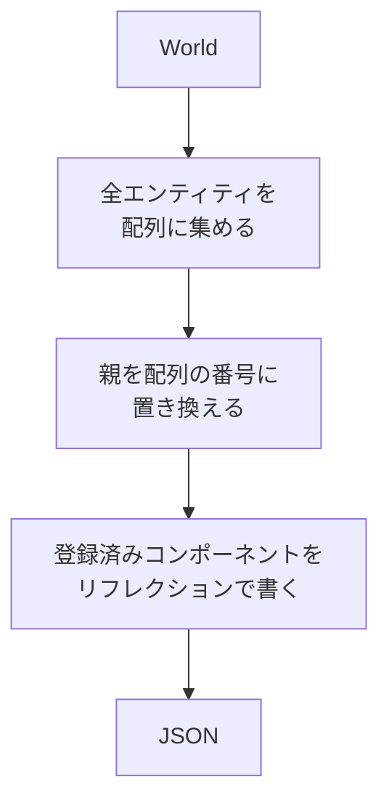

`SaveScene` / `LoadScene` が、ワールドを JSON に書き出し、読み戻します。エディタの保存・読み込みと、プレイモードの開始・復元が、これを使っています。

### 仕組み

ファイルには `version` と、エンティティの配列 `entities` があります。各エンティティは `parent` と `components` を持ちます。親子関係はハンドルではなく、配列の番号 (親の序数) で持ちます。親がないエンティティは -1 です。ファイルにハンドルの値は書きません。



保存するコンポーネントは、名前を付けて `RegisterSceneComponent<T>("名前")` で登録したものだけです。登録の条件は、リフレクションされていて、メモリ上でそのままコピーできる型であることです。前者は `NX_ASSERT`、後者は `static_assert` で検査します。

### 実装

書き出しは、登録済みコンポーネントを順に調べ、エンティティが持っているものだけをリフレクションの情報で書きます。

```cpp
// Engine/Scene/Src/SceneSerializer.cpp
const Parent* parent = world.Get<Parent>(entity);
const i64 parentOrdinal = (parent != nullptr && world.IsAlive(parent->value))
                              ? FindOrdinal(entities, parent->value)
                              : -1;
writer.Key("parent");
writer.Number(parentOrdinal);

writer.Key("components");
writer.BeginObject();
for (const detail::SceneComponentEntry& component : Registry())
{
    // ...
    writer.Key(component.name);
    JsonWriteObject(writer, componentData, *component.typeInfo);
}
```

読み込みでは、JSON にある名前が登録されていなければ、警告を出して読み飛ばします (`Skipping unknown scene component`)。親の番号が範囲外のときも検査しています。

### 設計判断

GPU のハンドルや物理のボディのような実行時の状態は、保存するコンポーネントに入れない決まりです。値がゴミになるうえ、決定論とプレイモードの復元 (保存して戻す) を壊すためです。実行時の状態は、登録しない別のコンポーネントに持たせます。これは ADR 034 に書かれた方針です。ただし ADR 034 の状態は「提案」で、標準コンポーネント群と実行時の状態の分離は、まだ最新のソースには入っていません。

### 限界

- ファイルの `version` は現在 1 のみです。ADR 034 は v2 への移行を提案していますが、実装されていません。
- 親子リンク以外のエンティティ参照は書けません。
- `RegisterSceneComponent` を呼んでいるのは、テストとエディタです (エディタ専用の型を登録)。`LoadScene` / `SaveScene` を呼ぶのも、エディタとテストだけで、Samples と Sandbox、Engine の他のモジュールは呼びません。
