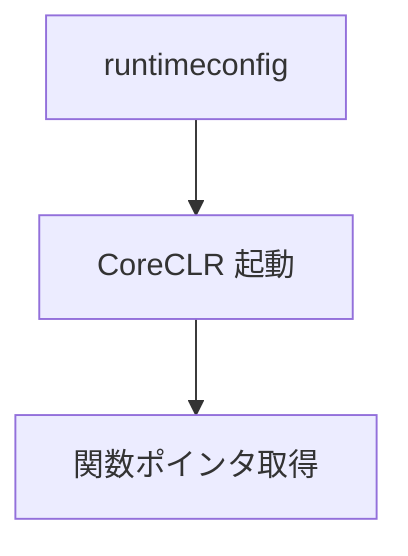

nethost / hostfxr で CoreCLR を起動し、C# の `[UnmanagedCallersOnly]` な静的メソッドを、C の関数ポインタとして受け取ります。C# 側からは普通の C 関数のように呼べます。

起動まで来ていて、できるのは関数ポインタを引くところまでです。.NET の SDK が見つかったときだけ有効になり、無い環境ではホストは「使えない」と返すだけで、エンジンはそのままビルドできます。エディタの新しい C# の UI は、このホストを通して起動します（ADR 037）。

### 仕組み

初期化には対象コンポーネントの runtimeconfig.json を渡します。取得に失敗すると null を返し、詳細を LastError で調べられます。



### 実装

```cpp
// Engine/Scripting/Include/Nexus/Scripting/DotNetHost.h
        // Boots the runtime from a component .runtimeconfig.json (idempotent). Returns false on
        // failure with details in LastError().
        bool Initialize(const char* runtimeConfigPath);

        // Resolves a static [UnmanagedCallersOnly] method to a raw callable pointer.
        // typeName: "Namespace.Type, AssemblyName"; methodName: the method name.
        // Returns nullptr on failure (see LastError()). Cast the result to the matching C
        // function-pointer type to call it.
        void* GetFunctionPointer(const char* assemblyPath, const char* typeName,
                                 const char* methodName);
```
