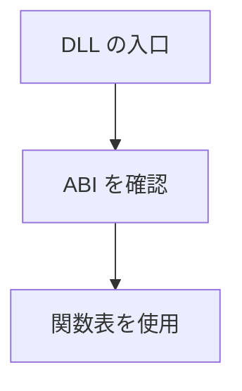

ゲームのコードを DLL にして読み込み、再読み込みできます。DLL は `NxGetGameModule` という入口だけを公開する C の ABI（バージョン番号つき）で、ABI が合わなければ読み込みを断ります。

現在のゲーム側の状態は、時刻・カウンタ・位置 64 個だけの小さな構造体です。エンジンの ECS を C++ のゲーム DLL から触る段階には、まだ来ていません。

### 仕組み

関数表には初期化、更新、終了、名前の取得と ABI バージョンの問い合わせがあります。境界にエンジンの型や STL を持ち込まない設計です。



### 実装

```cpp
// Engine/Scripting/Include/Nexus/Scripting/GameModuleApi.h
    struct NxGameState
    {
        float time;
        int   counter;
        float positions[64];
        int   entityCount;
    };

    struct NxGameModule
    {
        int (*abiVersion)(void);
        void (*init)(struct NxGameState* state);
        void (*update)(struct NxGameState* state, float dt);
        void (*shutdown)(struct NxGameState* state);
        const char* (*name)(void);
    };
```
